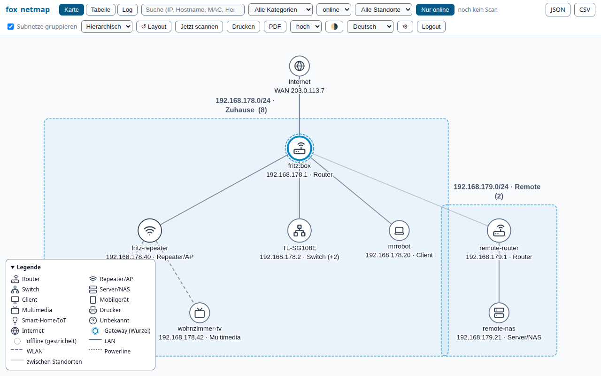

# fox_netmap

Scan and visualize a network as a map

🇩🇪 Deutsche Version: [README.md](README.md)



- [Requirements & target architecture](docs/01-anforderungen.md) (German)

## License

[MIT License](LICENSE) — Copyright (c) 2026 KaiDeWitzka.

fox_netmap may be used, modified and redistributed freely (commercial use included). The only condition: the copyright and license notice must be retained in all copies or substantial portions — anyone using the code should make that visible.

## Documentation

- [User manual](docs/02-benutzerhandbuch.en.md) — in 6 languages: [de](docs/02-benutzerhandbuch.md) · [en](docs/02-benutzerhandbuch.en.md) · [fr](docs/02-benutzerhandbuch.fr.md) · [es](docs/02-benutzerhandbuch.es.md) · [it](docs/02-benutzerhandbuch.it.md) · [pt](docs/02-benutzerhandbuch.pt.md) (quickstart, usage, screenshots, settings, embed, exports, troubleshooting, API)
- [Requirements & architecture](docs/01-anforderungen.md) (German)
- [Security concept](docs/03-sicherheit.md) (German) · [Report vulnerabilities](SECURITY.md) · [Changelog](CHANGELOG.md)
- [Node design plan v1.6.1](docs/plaene/v1.6.1-knotendesign.md) (German) — map nodes per target design, with decisions, contrast values and implementation status
- [Third-party components and licenses](THIRD_PARTY.md) — Cytoscape.js, Lucide icons, OUI list
- [Privacy notice](docs/04-datenschutz.md) (German) — what data is collected, stored and sent externally, retention periods, privacy-friendly configuration

## Quickstart (standalone Docker)

```bash
docker compose up -d --build
# Web UI: http://localhost:8399  (login: NETZ_AUTH_USER / NETZ_AUTH_PASS, default user "admin")
# Exports in the header: JSON, CSV, PDF (server-side via POST /api/export/pdf: map snapshot + device table, portrait/landscape selectable), print view
```

**Applying changes to `docker-compose.yml` / `.env`:** running containers never pick up compose changes automatically. After editing, run `docker compose up -d` — compose recreates changed services. `docker compose restart` alone is not enough: env vars, ports and command stay old. After image code changes: `docker compose up -d --build`. Data lives in the `./data` volume (SQLite, logs, exports) and survives every recreate; `docker compose down -v` deletes it. Check effective config: `docker compose config`.

Configuration via environment variables (`NETZ_*`, see `docker-compose.yml`) — defaults for fresh installs. Changeable at runtime without restart in **Settings**: subnets (incl. IPv6 CIDR), scan interval/timeout, ports (top-N/custom list), TR-064 (URL/URLs/user), SNMP (enabled/switches/community), alarm URLs (webhook/Gotify/Ntfy), history, retention, auto-export (on/interval/folder), mDNS, whitelist, sites, VPN address pool, theme, language, login on/off. **Secrets** (`NETZ_AUTH_PASS`, `NETZ_NOTIFY_*_TOKEN`) and deployment variables (`NETZ_DATA_DIR`, port, `TZ`) deliberately stay env-only in the compose file. `NETZ_FRITZ_PASS` is additionally changeable in Settings (write-only: never returned by `GET /api/settings`; empty = env default). Originally:
`NETZ_SUBNETS` (comma-separated, IPv4 + IPv6 CIDRs, empty = local subnet; IPv6 discovery in large networks via ff02::1 multicast + NDP + SLAAC/EUI-64 probe + DNS AAAA + gateway, in small ones additionally a sweep), `NETZ_SITES` (sites as `Name:subnet[,subnet]; Name2:subnet2` — display/filter/export, e.g. `Home:192.168.178.0/24; Remote:192.168.179.0/24`), `NETZ_SCAN_INTERVAL` (seconds, default 900),
`NETZ_PORT_TOP` (top-N ports, 0 = all), `NETZ_FRITZ_URL/USER/PASS` (TR-064, main device), `NETZ_FRITZ_URLS` (additional TR-064 endpoints, comma-separated, e.g. repeaters — their WLAN clients are assigned to the respective device),
`NETZ_SNMP_ENABLED/COMMUNITY/SWITCHES`, `NETZ_AUTH_ENABLED/USER/PASS`, `NETZ_NOTIFY_*`, `NETZ_HISTORY_HOURS`, `NETZ_DEVICE_RETENTION_DAYS` (delete offline devices after N days, default 30, 0 = never), `NETZ_EVENT_RETENTION_DAYS` (delete events after N days, default 90, 0 = never), `NETZ_SNMP_COMMUNITY` has had no default since v1.6.0 (no SNMP without a community), `NETZ_THEME`, `NETZ_LANG` (UI language: de/en/fr/es/it/pt, default de; switchable in the header, storable in Settings, embed via `?lang=`), `NETZ_AUTO_EXPORT`/`NETZ_AUTO_EXPORT_DIR`/`NETZ_AUTO_EXPORT_INTERVAL_HOURS` (auto-export, default every 24 h, 0 = after every scan), `NETZ_MDNS_ENABLED` (mDNS name resolution as DNS fallback, default on), `NETZ_OUI_ONLINE_ENABLED/MAX/URL` (online OUI fallback: look up vendors of unknown MACs online, **default off** since v1.5.0 — MAC prefixes would go to a third party, max 10 lookups/scan, cached in `oui_cache`), `NETZ_ALARM_WHITELIST` (MACs/IPs, comma-separated, that never trigger a "new device" alarm), `NETZ_EMBED_ANCESTORS` (pages allowed to embed `/embed` via iframe, CSP syntax, default `*`, e.g. `https://wiki.example.org`), `NETZ_COOKIE_SECURE` (`auto`/`true`/`false`, Secure flag of the session cookie, default `auto` = on HTTPS), `NETZ_VPN_POOL` (VPN address pool for flagging VPN clients, default `off` = no assumption; `auto` = FRITZ! convention: last octet ≥ 201 in the gateway's /24, alternatively CIDRs/ranges `a-b` comma-separated; TR-064 additionally detects VPN clients via interface type "VPN" — VPN devices get a VPN badge and never trigger a "new device" alarm).

The scanner container runs in host network mode (`network_mode: host`) so MAC addresses can be resolved via ARP. Data lives in `./data` (SQLite + exports).

**Container hardening (since v1.5.0):** Both containers run as UID/GID `10001` instead of root, with a read-only root filesystem and a Docker healthcheck. The web UI has no capabilities (`no-new-privileges`), the scanner only `NET_RAW` for ping. Existing data in `./data` is adopted automatically on first start. Without `NETZ_AUTH_PASS`, the initial password is in `./data/initial-admin-password.txt` (`sudo cat ./data/initial-admin-password.txt`). Details: [security concept](docs/03-sicherheit.md) (German).

**Topology ("Connected to"), priority:** manual mapping in the map (detail panel → "Connected to") > SNMP CAM table + LLDP MIB of managed switches > TR-064 endpoint (e.g. repeater the client is attached to) > TR-064 WLAN/LAN (WLAN devices hang on a virtual WLAN node) > gateway. Unmanaged switches (e.g. TL-SG108E without SNMP) are not visible automatically — assign them manually.

Update the OUI database: `python scripts/update_oui.py ./data` (downloads the IEEE OUI file to `data/oui.txt`).

## Releases

- The version lives in `app/__init__.py` (`__version__`), `pyproject.toml` and `app/config.py` (`app_version`). Current: **v1.6.4**
- SemVer since v1.0.0: releases are tags `vMAJOR.MINOR.PATCH` (e.g. `v1.0.0`, `v1.1.0`, `v2.0.0`) on `main`
- Push a tag (`git tag v1.1.0 && git push origin v1.1.0`) → workflow `release.yml` runs tests (ruff + pytest + UI-DOM), builds the multi-arch image (amd64/arm64), scans it with Trivy, publishes it to the GitHub Container Registry and creates a GitHub release with SBOM (CycloneDX, SPDX) and Trivy report
- The tag must match `app.__version__`, otherwise the release fails
- **Every push to `main`** (`main-scan.yml`): build image → Trivy gate (CRITICAL/HIGH with available fix) → SBOM + Trivy report as artifact → multi-arch push as `ghcr.io/kaidewitzka/fox_netmap:main` or `:sha-<sha>` (only after a green scan). Weekly re-scan (`image-scan.yml`) checks `:latest` and `:main` for newly published CVEs

## Prebuilt container image (GHCR, since v1.5.1)

Instead of building locally, use the published image (`linux/amd64`, `linux/arm64`):

```bash
docker pull ghcr.io/kaidewitzka/fox_netmap:latest     # or :1.6.4, :1.6, :1
```

Tags: `X.Y.Z`, `X.Y`, `X`, `latest` and `sha-<commit>`. While the repository is private, the package is private too: log in first with `docker login ghcr.io -u <github-name>` using a personal access token (only `read:packages` scope). In `docker-compose.yml`, replace `build: .` with `image: ghcr.io/kaidewitzka/fox_netmap:1.6.4` in both services, then `docker compose pull && docker compose up -d`.

Verify provenance: `docker buildx imagetools inspect ghcr.io/kaidewitzka/fox_netmap:1.6.4 --format '{{json .Provenance}}'` (provenance and SBOM attestations are attached to the image).

## Supply chain

- **Dependencies hash-pinned:** `requirements.in` / `requirements-dev.in` hold the allowed version ranges, `requirements.txt` / `requirements-dev.txt` the exact resolved versions with SHA-256 (install with `--require-hashes`). Update:
  ```bash
  pip install pip-tools
  pip-compile --generate-hashes --allow-unsafe --strip-extras -o requirements.txt requirements.in
  pip-compile --generate-hashes --allow-unsafe --strip-extras -o requirements-dev.txt requirements-dev.in
  ```
- **Base image and GitHub Actions pinned by digest/SHA**, Trivy runs via `scripts/trivy.sh` from a pinned image.
- **Trivy gate:** CI and release fail on `CRITICAL`/`HIGH` findings with an available fix. Exceptions only with justification in `.trivyignore`. Locally: `scripts/trivy.sh image <image>` (requires Docker).
- **Dependabot** (`.github/dependabot.yml`) proposes weekly updates for pip, npm, the Docker base image and actions; `image-scan.yml` re-checks `latest` every Monday.
- Details and baseline-protection mapping: [security concept, supply chain section](docs/03-sicherheit.md#29-lieferkette-supply-chain-seit-v151) (German).

## Development

```bash
pip install --require-hashes --no-deps -r requirements-dev.txt
ruff check .
python -m pytest -q
npm ci && node tests/ui_dom_check.mjs   # UI DOM audit (jsdom)
python -m app web       # web/API locally (NETZ_DATA_DIR=./data)
python -m app scanner   # scanner locally
```
