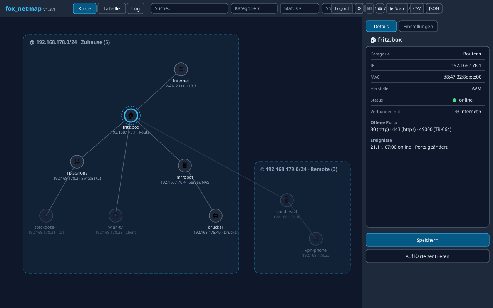

# fox_netmap
Scan and visualize a network as a map

🇬🇧 English version: [README.en.md](README.en.md)



- [Anforderungen & Zielarchitektur](docs/01-anforderungen.md)

## Lizenz

[MIT License](LICENSE) — Copyright (c) 2026 KaiDeWitzka.

fox_netmap darf frei genutzt, verändert und weitergegeben werden (auch kommerziell). Einzige Bedingung: Der Copyright- und Lizenzhinweis muss in allen Kopien/wesentlichen Teilen erhalten bleiben — wer den Code verwendet, soll das also kenntlich machen.

## Dokumentation

- [Benutzerhandbuch](docs/02-benutzerhandbuch.md) — in 6 Sprachen: [de](docs/02-benutzerhandbuch.md) · [en](docs/02-benutzerhandbuch.en.md) · [fr](docs/02-benutzerhandbuch.fr.md) · [es](docs/02-benutzerhandbuch.es.md) · [it](docs/02-benutzerhandbuch.it.md) · [pt](docs/02-benutzerhandbuch.pt.md) (Schnellstart, Bedienung, Screenshots, Settings, Embed, Exporte, Troubleshooting, API)
- [Anforderungen & Architektur](docs/01-anforderungen.md)
- [Sicherheitskonzept](docs/03-sicherheit.md) · [Sicherheitslücke melden](SECURITY.md) · [Changelog](CHANGELOG.md)
- [Plan Knotendesign v1.6.1](docs/plaene/v1.6.1-knotendesign.md) — Kartenknoten nach Soll-Entwurf, mit Entscheidungen, Kontrastwerten und Umsetzungsstand
- [Fremdkomponenten und Lizenzen](THIRD_PARTY.md) — Cytoscape.js, Lucide-Symbole, OUI-Liste
- [Datenschutzhinweis](docs/04-datenschutz.md) — welche Daten erhoben, gespeichert und nach außen gesendet werden, Löschfristen, datensparsame Konfiguration

## Quickstart (standalone Docker)

```bash
docker compose up -d --build
# Web-UI: http://localhost:8399  (Login: NETZ_AUTH_USER / NETZ_AUTH_PASS, Default-Benutzer "admin")
# Exporte im Header: JSON, CSV, PDF (serverseitig via POST /api/export/pdf: Karten-Snapshot + Geraetetabelle, hoch/quer wählbar), Druckansicht
```

**Änderungen an `docker-compose.yml` / `.env` anwenden:** Laufende Container übernehmen Compose-Änderungen nie automatisch. Nach dem Editieren `docker compose up -d` ausführen — Compose erstellt geänderte Services neu (Recreate). `docker compose restart` allein reicht nicht: Env-Variablen, Ports und Command bleiben dabei alt. Nach Code-Änderungen am Image: `docker compose up -d --build`. Die Daten liegen im Volume `./data` (SQLite, Log, Exporte) und überleben jedes Recreate; `docker compose down -v` löscht sie dagegen. Effektive Config prüfen: `docker compose config`.

Konfiguration über Umgebungsvariablen (`NETZ_*`, siehe `docker-compose.yml`) — Defaults für frische Installationen. Zur Laufzeit änderbar ohne Neustart sind in den **Einstellungen**: Subnetze (inkl. IPv6-CIDR), Scan-Intervall/-Timeout, Ports (Top-N/eigene Liste), TR-064 (URL/URLs/Benutzer), SNMP (aktiv/Switches/Community), Alarm-URLs (Webhook/Gotify/Ntfy), Historie, Retention, Auto-Export (an/Intervall/Ordner), mDNS, Whitelist, Standorte, VPN-Adresspool, Theme, Sprache, Login an/aus. **Secrets** (`NETZ_AUTH_PASS`, `NETZ_NOTIFY_*_TOKEN`) und Deployment-Variablen (`NETZ_DATA_DIR`, Port, `TZ`) bleiben bewusst env-only in der Compose. `NETZ_FRITZ_PASS` ist zusätzlich in den Einstellungen änderbar (write-only: wird nie von `GET /api/settings` ausgeliefert; leer = Env-Default). Ursprünglich:
`NETZ_SUBNETS` (kommagetrennt, IPv4 + IPv6 CIDRs, leer = lokales Subnetz; IPv6-Fund bei großen Netzen via ff02::1-Multicast + NDP + SLAAC/EUI-64-Probe (ping6 pro bekannter MAC) + DNS-AAAA pro Hostname + Gateway, bei kleinen zusätzlich Sweep), `NETZ_SITES` (Standorte als `Name:Subnetz[,Subnetz]; Name2:Subnetz2` — Anzeige/Filter/Export, z. B. `Zuhause:192.0.2.0/24; Remote:198.51.100.0/24`), `NETZ_SCAN_INTERVAL` (Sekunden, Default 900),
`NETZ_PORT_TOP` (Top-N-Ports, 0 = alle), `NETZ_FRITZ_URL/USER/PASS` (TR-064, Hauptgeraet), `NETZ_FRITZ_URLS` (weitere TR-064-Endpunkte kommagetrennt, z. B. Repeater — deren WLAN-Clients werden dem jeweiligen Geraet zugeordnet),
`NETZ_SNMP_ENABLED/COMMUNITY/SWITCHES`, `NETZ_AUTH_ENABLED/USER/PASS`, `NETZ_NOTIFY_*`, `NETZ_HISTORY_HOURS`, `NETZ_DEVICE_RETENTION_DAYS` (Geräte offline löschen nach N Tagen, Default 30, 0 = nie), `NETZ_EVENT_RETENTION_DAYS` (Ereignisse löschen nach N Tagen, Default 90, 0 = nie), `NETZ_SNMP_COMMUNITY` hat seit v1.6.0 keinen Default mehr (ohne Community kein SNMP), `NETZ_THEME`, `NETZ_LANG` (UI-Sprache: de/en/fr/es/it/pt, Default de; im Header umschaltbar, in Settings speicherbar, Embed via `?lang=`), `NETZ_AUTO_EXPORT`/`NETZ_AUTO_EXPORT_DIR`/`NETZ_AUTO_EXPORT_INTERVAL_HOURS` (Auto-Export, Default alle 24 h, 0 = nach jedem Scan), `NETZ_MDNS_ENABLED` (mDNS-Namensauflösung als DNS-Fallback, Default an), `NETZ_OUI_ONLINE_ENABLED/MAX/URL` (Online-OUI-Fallback: Hersteller unbekannter MACs online nachschlagen, **Default aus** seit v1.5.0 – MAC-Präfixe gehen an einen Drittanbieter, max 10 Lookups/Scan, gecacht in `oui_cache`), `NETZ_ALARM_WHITELIST` (MACs/IPs kommagetrennt, für die kein „neues Gerät“-Alarm ausgelöst wird), `NETZ_EMBED_ANCESTORS` (Seiten, die `/embed` per iframe einbinden dürfen, CSP-Syntax, Default `*`, z. B. `https://wiki.example.org`), `NETZ_COOKIE_SECURE` (`auto`/`true`/`false`, Secure-Flag des Session-Cookies, Default `auto` = bei HTTPS), `NETZ_VPN_POOL` (VPN-Adresspool zur Kennzeichnung von VPN-Clients, Default `off` = keine Annahme; `auto` = FRITZ!-Konvention: letzte Oktett ≥ 201 im /24 des Gateways, alternativ CIDRs/Bereiche `a-b` kommagetrennt; TR-064 erkennt VPN-Clients zusätzlich am Schnittstellentyp „VPN“ — VPN-Geräte bekommen ein VPN-Badge und lösen keinen „neues Gerät“-Alarm aus; Empfehlung: `auto` bei FRITZ!Box-VPN-Clients (.201+ im Gateway-/24), eigenes VPN-Subnetz als CIDR (z. B. `192.168.179.0/24`)). `NETZ_SQLITE_JOURNAL` (`auto`/`wal`/`delete`, Default `auto`: WAL wird per Schreibprobe geprueft, bei `disk I/O error` automatischer Fallback auf `delete`).

Der Scanner-Container läuft im Host-Netzwerkmodus (`network_mode: host`), damit MAC-Adressen per ARP aufgelöst werden können. Daten liegen in `./data` (SQLite + Exporte).

**Container-Härtung (seit v1.5.0):** Beide Container laufen als UID/GID `10001` statt root, mit schreibgeschütztem Root-Dateisystem und Docker-Healthcheck. Die Web-Oberfläche hat keine Capabilities (`no-new-privileges`), der Scanner nur `NET_RAW` für ping. Bestandsdaten in `./data` werden beim ersten Start automatisch übernommen. Ohne `NETZ_AUTH_PASS` liegt das Startpasswort in `./data/initial-admin-password.txt` (`sudo cat ./data/initial-admin-password.txt`). Details: [Sicherheitskonzept](docs/03-sicherheit.md).
Bei `sqlite3.OperationalError: disk I/O error` (typisch Docker Desktop/virtiofs oder NAS als Daten-Volume: WAL-shm nicht nutzbar): `NETZ_SQLITE_JOURNAL=delete` setzen — seit v1.6.10 automatischer Fallback, seit v1.6.11 zusaetzlich Schreibprobe beim Start und nicht-fatales Dedupe.

**Topologie („Verbunden mit“), Priorität:** manuelles Mapping in der Karte (Detail-Panel → „Verbunden mit“) > SNMP CAM-Tabelle + LLDP-MIB verwalteter Switche > TR-064-Endpunkt (z. B. Repeater, an dem der Client hängt) > TR-064 WLAN/LAN (WLAN-Geräte hängen an einem virtuellen WLAN-Knoten) > Gateway. Unmanaged Switche (z. B. TL-SG108E ohne SNMP) sind nicht automatisch sichtbar — dort manuell zuordnen.

OUI-Datenbank aktualisieren: `python scripts/update_oui.py ./data` (lädt die IEEE-OUI-Datei nach `data/oui.txt`).

## Releases

- Version steht in `app/__init__.py` (`__version__`), `pyproject.toml` und `app/config.py` (`app_version`). Aktuell: **v1.6.4**
- SemVer ab v1.0.0: Releases tragen Tags im Format `vMAJOR.MINOR.PATCH` (z. B. `v1.0.0`, `v1.1.0`, `v2.0.0`) auf `main`
- Tag pushen (`git tag v1.1.0 && git push origin v1.1.0`) → Workflow `release.yml` testet (ruff + pytest + UI-DOM), baut das Multi-Arch-Image (amd64/arm64), prüft es mit Trivy, veröffentlicht es in der GitHub Container Registry und erstellt ein GitHub-Release mit SBOM (CycloneDX, SPDX) und Trivy-Bericht
- Tag muss zu `app.__version__` passen, sonst bricht der Release ab
- **Jeder Push auf `main`** (`main-scan.yml`): Image bauen → Trivy-Gate (CRITICAL/HIGH mit Fix) → SBOM + Trivy-Bericht als Artefakt → Multi-Arch-Push als `ghcr.io/kaidewitzka/fox_netmap:main` bzw. `:sha-<sha>` (nur nach grünem Scan). Wöchentlicher Nachscan (`image-scan.yml`) prüft `:latest` und `:main` auf neu bekannt gewordene CVEs

## Fertiges Container-Image (GHCR, seit v1.5.1)

Statt lokal zu bauen, kann das veröffentlichte Image genutzt werden (`linux/amd64`, `linux/arm64`):

```bash
docker pull ghcr.io/kaidewitzka/fox_netmap:latest     # oder :1.6.4, :1.6, :1
```

Tags: `X.Y.Z`, `X.Y`, `X`, `latest`, `main` und `sha-<commit>`. Das Paket ist **öffentlich** — `docker pull` funktioniert ohne Login. In `docker-compose.yml` bei beiden Diensten `build: .` durch `image: ghcr.io/kaidewitzka/fox_netmap:1.6.4` ersetzen, dann `docker compose pull && docker compose up -d`.

Herkunft prüfen: `docker buildx imagetools inspect ghcr.io/kaidewitzka/fox_netmap:1.6.4 --format '{{json .Provenance}}'` (Provenance- und SBOM-Attestierung hängen am Image).

## Lieferkette (Supply Chain)

- **Abhängigkeiten hash-gepinnt:** `requirements.in` / `requirements-dev.in` enthalten die zulässigen Versionsbereiche, `requirements.txt` / `requirements-dev.txt` die exakt aufgelösten Versionen mit SHA-256 (Installation mit `--require-hashes`). Aktualisieren:
  ```bash
  pip install pip-tools
  pip-compile --generate-hashes --allow-unsafe --strip-extras -o requirements.txt requirements.in
  pip-compile --generate-hashes --allow-unsafe --strip-extras -o requirements-dev.txt requirements-dev.in
  ```
- **Basis-Image und GitHub Actions per Digest/SHA gepinnt**, Trivy läuft über `scripts/trivy.sh` aus einem gepinnten Image.
- **Trivy-Gate:** CI und Release brechen bei Schwachstellen `CRITICAL`/`HIGH` ab, für die ein Fix existiert. Ausnahmen nur begründet in `.trivyignore`. Lokal: `scripts/trivy.sh image <image>` (Docker nötig).
- **Dependabot** (`.github/dependabot.yml`) schlägt wöchentlich Updates für pip, npm, Docker-Basis-Image und Actions vor; `image-scan.yml` prüft `latest` jeden Montag erneut.
- Details und Grundschutz-Bezug: [Sicherheitskonzept, Abschnitt Lieferkette](docs/03-sicherheit.md#29-lieferkette-supply-chain-seit-v151).

## Entwicklung

```bash
pip install --require-hashes --no-deps -r requirements-dev.txt
ruff check .
python -m pytest -q
python -m app web       # Web/API lokal (NETZ_DATA_DIR=./data)
python -m app scanner   # Scanner lokal
```
