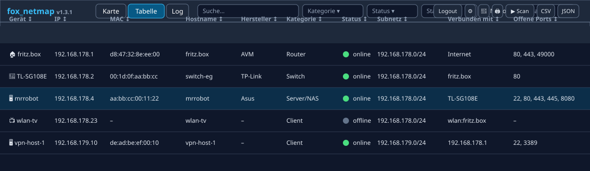

# fox_netmap — User Manual

Version 1.3.x · November 2026

> Languages: [Deutsch](02-benutzerhandbuch.md) · [English](02-benutzerhandbuch.en.md) · [Français](02-benutzerhandbuch.fr.md) · [Español](02-benutzerhandbuch.es.md) · [Italiano](02-benutzerhandbuch.it.md) · [Português](02-benutzerhandbuch.pt.md)

fox_netmap is an interactive, searchable network map for your home network: up to ~200 devices
across multiple subnets/VLANs, with topology ("connected to"), open ports, history, alarms and
exports (JSON/CSV/PDF print). Data persists in SQLite; scans run cyclically or manually.

> The images in this manual (`docs/screenshots/*.svg`) are schematic illustrations of the real UI
> (dark theme) — layout and elements match the app 1:1.

**Contents**

1. [Quick start](#1-quick-start)
2. [The interface](#2-the-interface)
3. [Using the map](#3-using-the-map)
4. [Table](#4-table)
5. [Log view](#5-log-view)
6. [Device details](#6-device-details)
7. [Search & filter](#7-search--filter)
8. [Settings](#8-settings)
9. [Embed (embeddable, read-only)](#9-embed-embeddable-read-only)
10. [Exports](#10-exports)
11. [Scanner & data model](#11-scanner--data-model)
12. [Topology ("connected to")](#12-topology-connected-to)
13. [Multiple sites & IPv6](#13-multiple-sites--ipv6)
14. [Security](#14-security)
15. [Operations & deployment](#15-operations--deployment)
16. [REST API (overview)](#16-rest-api-overview)
17. [Troubleshooting](#17-troubleshooting)
18. [Accessibility](#18-accessibility)
19. [Glossary](#19-glossary)

---

## 1. Quick start

**Requirements:** Docker + Docker Compose on the host (the scanner needs `network_mode: host`
so ARP/ping work in the real network).

```bash
git clone https://github.com/KaiDeWitzka/fox_netmap.git
cd fox_netmap
# optional: create .env, e.g.
#   NETZ_SUBNETS=192.168.178.0/24,192.168.179.0/24
#   NETZ_FRITZ_URL=http://192.168.178.1:49000
#   NETZ_FRITZ_USER=…   NETZ_FRITZ_PASS=…
docker compose up -d --build
```

- Web UI: **http://localhost:8399**
- On first start with an empty `NETZ_AUTH_PASS`, a random password is generated once and stored in
  `./data/initial-admin-password.txt` (owner-readable only, not logged). Default login: `admin`.
  Then set `NETZ_AUTH_PASS` – the file is deleted automatically.
- The first scan runs automatically after `NETZ_SCAN_INTERVAL` (default 900 s) or immediately
  via **▶ Scan** in the header.
- Data lives in the `./data` volume (SQLite `netmap.db`, log `netmap.log`, exports) and survives
  `docker compose up -d --build` (recreate). **`down -v` deletes the data!**

> After code updates always run `docker compose up -d --build` (new image + recreate).

---

## 2. The interface


The header contains (left to right): logo/version, navigation **Map / Table / Log**, search,
filters (category, status, site), **Only online**, layout selector, exports (JSON/CSV),
**▶ Scan**, print (PDF), theme (🌙/☀), **⚙ Settings**, logout.

Clicking a device (or ⚙) opens the right sidebar with the tabs **Details** and **Settings**.

---

## 3. Using the map

- **Zoom/pan:** mouse wheel zooms, dragging the background pans. Device positions are saved
  (dragging a node persists via API).
- **Click a device:** spotlight — the device and its direct connections are highlighted, the rest
  is dimmed; details open on the right. Click the background again to clear.
- **"Only online":** hides offline devices (persisted in localStorage).
- **"Group subnets":** devices are grouped per subnet in a frame (label `subnet · site (count)`).
  Edges stay between devices, also across subnets.
- **Collapse/expand children:** in the detail panel of a router/switch, a button hides all
  directly attached devices; the node then shows `(+N)`.
- **Layout:** `auto` (default) arranges the map as a tree by topology: internet at the top, below it the
  router, switches/repeaters and end devices. Many end devices on one node are placed in a compact grid below
  it; devices without a parent sit below the tree. If positions are saved for all devices (dragging), `auto`
  uses them. Other layouts: `tree` (always tree), `force` (physics), `concentric`, `circle`, `grid`.
  **Reset** clears saved positions.
- **Auto declutter:** compact nodes (20 px), thin edges (WLAN dashed, internet uplink stronger); labels fully
  visible only from zoom ≥ 0.85 (below that only hubs: router/switch/gateway/internet); above 25 devices subnet
  groups are enabled automatically; “Only online” is on by default (toggleable).
- Virtual nodes: **🌐 Internet** (with WAN IP from TR-064, otherwise "?"), **🏠 Gateway** (if the
  gateway itself is not in the device list) and **📶 wlan:…** for WLAN devices without their own node.
- Category emoji on nodes: 🏠 Router · 🔀 Switch · 🖥 Server/NAS · 💻 Client · 🖨 Printer ·
  💡 Smart home/IoT · ❓ Unknown.

---

## 4. Table



- **Reorder columns:** drag a header cell — order is saved (localStorage).
- **Column width:** drag the divider in the header — width is saved.
- **Sort:** click a column header.
- **Change category inline:** dropdown in the category column.
- Hostname/IP with web UI ports (80/8080/443/8443) render as clickable links (http + https,
  IPv6 in `[…]`).
- Devices without a MAC (e.g. pure IP finds from the VPN subnet) show "–" as MAC.

---

## 5. Log view


The **Log** view showsLevels are color-coded (INFO blue, WARN amber, ERROR red).  `netmap.log` (rotating, 1 MB × 3) with auto-refresh every 5 s, level
filter, and download of the full file. The same is provided by `/api/logs` and
`/api/logs/download`.

---

## 6. Device details

Right, in the **Details** tab: category (editable), IP/MAC/hostname/vendor (OUI), status,
subnet, site, scan source(s) (e.g. `arp,tr064`), "connected to" (manually selectable, empty =
automatic), open ports with service names, note, history (online/offline/ports) and events.
**Save** persists category/note/manual connection.

---

## 7. Search & filter

- **Search:** matches hostname, IP, MAC, vendor, note (live filter).
- **Filters:** category, status (online/offline), site — combinable, apply to map and table.
- **Only online:** quick toggle in the header.

---

## 8. Settings


Everything changed here takes effect **on the next scan without restarting the container**
(compose env values remain the defaults for fresh installs; empty = env default).

| Field | Env equivalent | Meaning |
|---|---|---|
| Subnets | `NETZ_SUBNETS` | comma-separated, IPv4 and IPv6 CIDR (e.g. `192.168.178.0/24, 2003:db8::/64`) |
| Scan interval / timeout | `NETZ_SCAN_INTERVAL` / `NETZ_SCAN_TIMEOUT` | seconds; interval 30–86400 |
| Port scope / custom ports | `NETZ_PORT_TOP` / `NETZ_PORTS` | top N (0 = all) or custom list `80,443,…` |
| SNMP on / switches / community | `NETZ_SNMP_ENABLED` / `_SWITCHES` / `_COMMUNITY` | CAM table + LLDP of switches (161/udp). Community has no default (since v1.6.0); without one SNMP is skipped |
| TR-064 main device / more endpoints / user / password | `NETZ_FRITZ_URL` / `_URLS` / `_USER` / `_PASS` | URL or `host:port`; repeaters as extra endpoints; password is **write-only** (never returned by GET, empty = unchanged) |
| Alarm URLs (webhook/Gotify/Ntfy) | `NETZ_NOTIFY_*` | `http(s)://…`; tokens stay env-only (`NETZ_NOTIFY_*_TOKEN`) |
| Whitelist | `NETZ_ALARM_WHITELIST` | MACs/IPs that do not trigger a "new device" alarm |
| Sites | `NETZ_SITES` | `Name:subnet; …` e.g. `Home:192.168.178.0/24; Remote:192.168.179.0/24` |
| History / retention | `NETZ_HISTORY_HOURS` / `NETZ_DEVICE_RETENTION_DAYS` | history in hours; delete offline devices after N days (0 = never) |
| Event retention | `NETZ_EVENT_RETENTION_DAYS` | delete events after N days, default 90 (0 = never) |
| Auto export / interval / folder | `NETZ_AUTO_EXPORT` / `_INTERVAL_HOURS` / `_DIR` | JSON+CSV automatically; interval in h (0 = after every scan) |
| mDNS | `NETZ_MDNS_ENABLED` | hostnames via mDNS PTR as fallback (+ DNS-SD, v1.6.0) |
| Online OUI fallback / max lookups per scan / API URL | `NETZ_OUI_ONLINE_ENABLED` / `_MAX` / `_URL` | look up vendors of unknown MACs online (default `https://api.macvendors.com`), **off by default** (privacy: MAC prefixes are sent to a third party), cached in the DB |
| Login enabled | `NETZ_AUTH_ENABLED` | session login on/off (user/pass stay env-only) |
| Theme / language | `NETZ_THEME` / `NETZ_LANG` | dark/light; de/en/fr/es/it/pt |

**Validation:** invalid input (e.g. `not-an-ip` as subnet, port `abc`, webhook without
`https://`) is reported in the frontend immediately and rejected by the backend with HTTP 422.

---

## 9. Embed (embeddable, read-only)

In Settings (**Embed tokens**) create a token — optionally with expiry and filters
(subnets/categories). Embed via:

```html
<iframe src="https://netmap.example.com/embed?token=ABC123&lang=en" width="100%" height="600"></iframe>
```

The token is shown only right after creation; only a hash is stored (since v1.6.0). Copy it immediately; the list then shows only the first 6 characters.

The embed is read-only (no editing, no settings), respects the token filters and can be adjusted
with `?theme=dark|light` and `?lang=…`.

---

## 10. Exports

- **JSON / CSV** in the header: full export of all devices incl. ports, history, connections,
  sites. CSV with selectable separator (`/api/export/csv?sep=;`).
- **Print → PDF:** print-optimized view (browser "Save as PDF").
- **Auto export:**
- **PDF (server-side):** **PDF** button in the header — map snapshot (PNG) + device table as a real PDF via `POST /api/export/pdf`  (also with an embed token, filters via query params). Portrait/landscape selectable via the select next to the button (remembered, `orientation` in the POST body); long cells wrap instead of overlapping. enable in Settings; writes JSON+CSV after each interval into the export
  folder (relative to the data volume, default `exports`).

---

## 11. Scanner & data model

Two compose services share the `./data` volume:

- `netmap` — web/API (port 8399)
- `netmap-scanner` — `command: ["scanner"]`, `network_mode: host`, caps `NET_RAW`

**Sources per scan (merge priority):** ping sweep + ARP (`/proc/net/arp`) + TCP probe
(80/443/22/445/8080) for ICMP-blocked hosts (e.g. VPN subnet) → TR-064 (main device +
`NETZ_FRITZ_URLS`, merge by IP, repeaters via `tr064_parent`) → SNMP (CAM/LLDP) → mDNS/DNS.
MAC conflicts: the ARP MAC wins. Duplicates (same IP) are merged automatically at startup.

**Cycle:** default every 900 s + manual trigger (▶ Scan). Each scan writes history
(`device_history`), events (`device_events`, incl. online/offline/port changes/new) and fires
alarms (webhook/Gotify/Ntfy on new device — except whitelisted).

**Retention:** offline devices are deleted after `NETZ_DEVICE_RETENTION_DAYS` (default 30,
0 = never).

**Device categories (since v1.6.0):** Router, Repeater/AP, Switch, Server/NAS, Client, Mobile device, Multimedia,
Printer, Smart home/IoT, Unknown. Every signal awards points, the highest total wins:
default gateway (100) > FRITZ!Box mesh role (50) > mDNS model, e.g. `iPhone14,2` (8) > hostname (6) >
mDNS service, e.g. `_ipp._tcp` (4) > vendor from OUI (3) > open ports (1–5) > private Wi-Fi address (1).
Hostnames only match at word start (`ring-door` yes, `string` no). Port 53 alone no longer makes a device a router,
SMB (445) alone counts as client. Ambiguous vendors such as Apple, Samsung or TP-Link are not scored. In addition to
the port list, the scanner checks a few unambiguous high ports (e.g. 62078 iOS, 8009 Google Cast, 1400 Sonos,
8006 Proxmox), unless `NETZ_PORTS` defines a custom list. The detail panel shows under **Detected via** which signal
decided. A manually set category always wins. The mDNS service query is a single request in the local network and
follows `NETZ_MDNS_ENABLED`.

---

## 12. Topology ("connected to")

Priority: **manual** (detail panel) > **SNMP** (CAM+LLDP) > **FRITZ!Box mesh** (TR-064) > **TR-064** (repeater/hotspot devices) >
**WLAN** (`wlan:…` when TR-064 marks the host as WLAN) > **gateway**.
The connection type `lan`/`wlan`/`plc` is stored as well. Edges point from the parent to the device
(basis of the tree layout). If `connected to` is an IP or hostname, it is mapped to the matching device; only
if none exists, a virtual gateway node is created.

**Assign several devices (since v1.6.0):** In the table, tick the devices in the first column (the header box selects all), choose the router, switch or repeater under **Connected to** and press **Set**. **auto** removes the manual assignment. The change applies to all ticked devices or to none. Assignments that would create a loop are rejected. The boxes work with Tab and Space, and the result is announced to screen readers.

**FRITZ!Box mesh (since v1.6.0):** Via TR-064 (`X_AVM-DE_GetMeshListPath`) fox_netmap reads the box's mesh
topology: which device hangs off which repeater or LAN port, via LAN or WLAN (band). The detail panel shows the
port, e.g. `WLAN · 5 GHz` or `LAN · LAN 1`. According to AVM, the TR-064 user needs the "App" or "Phone" right.
Disable with `NETZ_FRITZ_MESH=false`. The mesh list is loaded only from the local network (relative path only, no
redirects, max. 5 MB); the session ID in the path is never logged. The log shows `Mesh: X Knoten, Y Repeater, Z Zuordnungen`.

**Switch heuristic:** Unmanaged switches are invisible to the box. If it sees several devices on one LAN port and
exactly one of them is categorised as a switch, the others are assigned to that switch. With two switches on the
same port, the assignment stays with the router; use manual assignment then.

---

## 13. Multiple sites & IPv6

Example (VPN site as in your own network):

```env
NETZ_SUBNETS=192.168.178.0/24,192.168.179.0/24
NETZ_SITES=Home:192.168.178.0/24; Remote:192.168.179.0/24
```

→ site filter in the header, "Site" column in the table, site label in the subnet groups,
`site` field in exports. The remote subnet is discovered via TCP probe even when ICMP is blocked.

IPv6: just add a v6 CIDR to the subnets; discovery in large networks via NDP + gateway ping,
plus sweep for small ones; gateway-v6 for the topology; web links as `[2003:db8::10]:8080`.

---

## 14. Security

- **Since v1.5.0:** password hash PBKDF2-SHA256 with 600,000 iterations (old hashes are upgraded automatically on next login); expired sessions are cleaned up; session cookie gets `Secure` over HTTPS (`NETZ_COOKIE_SECURE=auto|true|false`); online vendor lookup off by default.
- **Since v1.4.1:** all network and user data is HTML-encoded before display (XSS protection); security headers (CSP, `X-Frame-Options`, `Referrer-Policy: no-referrer`) on all responses; login lockout for 15 minutes after 5 failed attempts (IP+user) or 20 (IP) (HTTP 429).
- `NETZ_EMBED_ANCESTORS` defines which sites may embed `/embed` in an iframe (default `*`; recommended: list your own domains).
- Details (German): [security concept](03-sicherheit.md).
- Session login (PBKDF2, cookie `fox_session`), on by default; `NETZ_AUTH_ENABLED=false` disables it.
- `NETZ_AUTH_USER`/`NETZ_AUTH_PASS` are env-only; empty password → random initial password in `./data/initial-admin-password.txt` (no longer logged since v1.5.0).
- `GET /api/settings` returns **no secrets** (test-covered): no `auth_pass`, `fritz_pass` or
  `notify_*_token`. The TR-064 password is write-only in Settings.
- Embed tokens: expirable, filterable, read-only; token-authenticated API paths are only
  `/api/devices`, `/api/device/…`, `/api/export/…`.
- The scanner runs with minimal caps (`NET_RAW`), read-only towards the network.
- **Privacy:** which data is collected, stored and sent outside is described in the [privacy notice](04-datenschutz.md) (German). Since v1.5.2 individual devices can be removed in the detail panel under **Delete device**, including history, ports and events (with confirmation). If the device is still on the network, it reappears with the next scan.

---

## 15. Operations & deployment

```bash
docker compose up -d --build          # after every update (recreate, data stays in ./data)
docker compose logs -f netmap-scanner  # scanner log live
docker compose down                    # stop (data stays)
docker compose down -v                 # WARNING: deletes ./data (DB, log, exports)!
```

- Health: `GET /api/health` → `{ "status": "ok", "version": "1.5.2" }`
- Since v1.5.0 containers **no longer run as root** but as UID/GID `10001`. The web UI has no capabilities and a read-only root filesystem; the scanner keeps only `NET_RAW` for ping.
- On the first start after the update, the container automatically hands over existing files in `./data` to UID 10001. On the host, use `sudo` to read them or add your user to a group with GID 10001.
- Docker healthcheck: `docker compose ps` shows `healthy`/`unhealthy` (web: `/api/health`, scanner: scan loop running).
- Volumes: `./data:/data` (SQLite WAL, rotating `netmap.log`, `exports/`)
- Ports: `NETMAP_PORT` (host) → 8399 (container)
- Timezone: `TZ=Europe/Berlin`
- Releases: SemVer tags `vX.Y.Z` run through `release.yml` (ruff + pytest + UI tests) and
  automatically create a GitHub release.
- Prebuilt image (since v1.5.1): `docker pull ghcr.io/kaidewitzka/fox_netmap:latest` (amd64/arm64). While the repository is private, run `docker login ghcr.io` with a token (`read:packages`) first. In the Compose file replace `build: .` with `image: ghcr.io/kaidewitzka/fox_netmap:<version>`. Every image is checked with Trivy; SBOM and scan report are attached to the GitHub release.

---

## 16. REST API (overview)

| Endpoint | Purpose |
|---|---|
| `GET /api/health` | health + version (public) |
| `GET /api/devices?q=&category=&status=&subnet=&site=` | device list, filterable |
| `PATCH /api/device/{mac}` | edit category/note/"connected to"/position |
| `DELETE /api/device/{mac}` | delete device incl. history, ports and events (login required) |
| `GET /api/device/{mac}` | details incl. ports/history/events |
| `POST /api/scan` · `GET /api/scan/status` | trigger scan / status |
| `GET /api/settings` · `PATCH /api/settings` | read settings (no secrets) / change (422 if invalid) |
| `GET/POST /api/tokens` · `DELETE /api/tokens/{id}` | manage embed tokens |
| `POST /api/devices/connect` | bulk assignment: `{"macs": [...], "connected_to": "<MAC>"}`, `""` = auto |
| `GET /api/export/json` · `GET /api/export/csv?sep=,` | exports |
| `GET /api/logs?lines=200&level=WARNING` · `GET /api/logs/download` | log |
| `GET /api/meta` | WAN IP, gateway, version, subnets (public) |
| `GET /api/sites` · `GET /api/categories` | sites / categories (public) |
| `POST /api/layout/reset` | clear saved node positions |

Auth: session cookie after `POST /api/login`; embed token instead of session for the token paths.

---

## 17. Troubleshooting

| Symptom | Cause / fix |
|---|---|
| “Too many failed attempts” at login | Login lockout active (HTTP 429). Wait 15 minutes or restart the container (`docker compose restart netmap`). |
| Embed not shown in iframe | `NETZ_EMBED_ANCESTORS` does not include the embedding site. Add the domain and run `docker compose up -d`. |
| Device missing in the VPN subnet | ICMP blocked → TCP probe kicks in automatically; visible in the log (`WARN … TCP probe ok`). Add the subnet in Settings. |
| TR-064 errors in the log | https→http fallback is automatic; check URL/user/password in Settings (password write-only). SOAP faults are logged as plain text. |
| Switch without neighbours | TL-SG108E etc. without SNMP → port 80 only; set topology manually in the detail panel. |
| "Duplicate" device | same IP with two MACs → ARP MAC wins, the rest is deduplicated at startup. |
| Old devices disappearing | retention active (default 30 days offline) — set to `0` = never in Settings. |
| Map cluttered | enable "Group subnets" + collapse children on router/switch + try `tree`/`grid` layout. |
| Forgot login | set `NETZ_AUTH_PASS` in compose/.env and `docker compose up -d --build`. |
| Start from scratch | `docker compose down -v && docker compose up -d --build` — deletes the DB! Back up exports first. |

The **Log** tab + `docker compose logs netmap-scanner` show every scan step.

---

## 18. Accessibility

- Keyboard navigation: tab through header/views, Enter activates; visible focus rings.
- Contrasts checked in dark/light theme; status also textual ("online/offline"), not color-only.
- aria-labels on icon-only buttons, live region for status messages.
- Full BITV 2.1 conformance is the goal — feedback welcome (repo issue).
- **Reduce motion (since v1.5.2):** if “reduce motion” is enabled in the operating system (`prefers-reduced-motion`), fox_netmap shows no animations or transitions; a running scan is shown as a steady dot plus text. Otherwise the dot pulses only three times (under 5 seconds) and then stays still (WCAG 2.2.2, 2.3.3). The map is always laid out without animation.
- The scan status is announced to screen readers only when it actually changes, not on every poll.

---

## 19. Glossary

- **OUI** — vendor identification via the first 3 MAC bytes (local DB `app/data/oui_seed.txt`).
- **TR-064** — AVM SOAP interface of the FRITZ!Box (host list, WAN IP, WLAN clients).
- **CAM table** — switch MAC-port table via SNMP (Q-BRIDGE/BRIDGE-MIB).
- **LLDP** — neighbour discovery via SNMP (LLDP-MIB), e.g. `lldpRemChassisId`.
- **Retention** — automatic deletion of devices that have been offline for a long time.
- **Spotlight** — highlighting a device + its direct connections on the map.
- **Site** — a name for a subnet (`NETZ_SITES`), e.g. "Remote" for the VPN network.

---

*Questions or bugs? Open an issue in `KaiDeWitzka/fox_netmap` — requirements are in
`docs/01-anforderungen.md`.*
