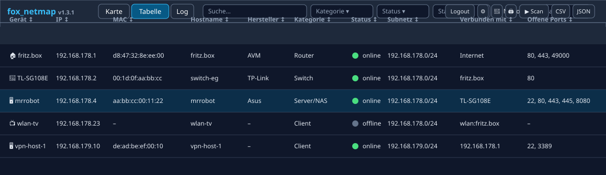

# fox_netmap — Manual del usuario

Versión 1.3.x · noviembre de 2026

> Idiomas: [Deutsch](02-benutzerhandbuch.md) · [English](02-benutzerhandbuch.en.md) · [Français](02-benutzerhandbuch.fr.md) · [Español](02-benutzerhandbuch.es.md) · [Italiano](02-benutzerhandbuch.it.md) · [Português](02-benutzerhandbuch.pt.md)

fox_netmap es un mapa de red interactivo y buscable para tu red doméstica: hasta ~200
dispositivos en varias subredes/VLAN, con topología («conectado a»), puertos abiertos,
historial, alarmas y exportaciones (JSON/CSV/impresión PDF). Los datos se guardan de forma
persistente en SQLite; los escaneos son cíclicos o manuales.

> Las imágenes de este manual (`docs/screenshots/*.svg`) son ilustraciones esquemáticas de la
> interfaz real (tema oscuro): la estructura y los elementos coinciden 1:1 con la aplicación.

**Índice**

1. [Inicio rápido](#1-inicio-rápido)
2. [La interfaz](#2-la-interfaz)
3. [Usar el mapa](#3-usar-el-mapa)
4. [Tabla](#4-tabla)
5. [Vista de registro](#5-vista-de-registro)
6. [Detalles del dispositivo](#6-detalles-del-dispositivo)
7. [Búsqueda y filtros](#7-búsqueda-y-filtros)
8. [Configuración](#8-configuración)
9. [Integración (embed, solo lectura)](#9-integración-embed-solo-lectura)
10. [Exportaciones](#10-exportaciones)
11. [Escáner y modelo de datos](#11-escáner-y-modelo-de-datos)
12. [Topología («conectado a»)](#12-topología-conectado-a)
13. [Varios sitios e IPv6](#13-varios-sitios-e-ipv6)
14. [Seguridad](#14-seguridad)
15. [Operación y despliegue](#15-operación-y-despliegue)
16. [API REST (resumen)](#16-api-rest-resumen)
17. [Solución de problemas](#17-solución-de-problemas)
18. [Accesibilidad](#18-accesibilidad)
19. [Glosario](#19-glosario)

---

## 1. Inicio rápido

**Requisitos:** Docker + Docker Compose en el host (el escáner necesita `network_mode: host`
para que ARP/ping funcionen en la red real).

```bash
git clone https://github.com/KaiDeWitzka/fox_netmap.git
cd fox_netmap
# opcional: crear .env, p. ej.
#   NETZ_SUBNETS=192.168.178.0/24,192.168.179.0/24
#   NETZ_FRITZ_URL=http://192.168.178.1:49000
#   NETZ_FRITZ_USER=…   NETZ_FRITZ_PASS=…
docker compose up -d --build
```

- Interfaz web: **http://localhost:8399**
- En el primer arranque con `NETZ_AUTH_PASS` vacío se genera una vez una contraseña aleatoria y se guarda en
  `./data/initial-admin-password.txt` (solo legible por el propietario, no en los logs). Login por defecto: `admin`.
  Después, define `NETZ_AUTH_PASS`: el archivo se borra automáticamente.
- El primer escaneo se ejecuta automáticamente tras `NETZ_SCAN_INTERVAL` (900 s por defecto) o
  de inmediato con **▶ Scan** en la cabecera.
- Los datos viven en el volumen `./data` (SQLite `netmap.db`, log `netmap.log`, exportaciones) y
  sobreviven a `docker compose up -d --build` (recreación). **¡`down -v` borra los datos!**

> Tras cada actualización de código, ejecutar siempre `docker compose up -d --build`.

---

## 2. La interfaz


La cabecera contiene (de izq. a dcha.): logo/versión, navegación **Mapa / Tabla / Registro**,
búsqueda, filtros (categoría, estado, sitio), **Solo en línea**, selector de diseño, exportaciones
(JSON/CSV), **▶ Scan**, imprimir (PDF), tema (🌙/☀), **⚙ Configuración**, cerrar sesión.

Al hacer clic en un dispositivo (o en ⚙) se abre el panel derecho con las pestañas
**Detalles** y **Configuración**.

---

## 3. Usar el mapa

- **Zoom/pan:** la rueda hace zoom, arrastrar el fondo desplaza. Las posiciones de los
  dispositivos se guardan (arrastrar un nodo se persiste vía API).
- **Clic en un dispositivo:** foco (spotlight) — el dispositivo y sus conexiones directas se
  resaltan, el resto se atenúa; los detalles se abren a la derecha. Otro clic en el fondo lo limpia.
- **«Solo en línea»:** oculta los dispositivos sin conexión (se guarda en localStorage).
- **«Agrupar subredes»:** los dispositivos se agrupan por subred en un marco (etiqueta
  `subred · sitio (nº)`). Las aristas entre subredes distintas van de grupo a grupo.
- **Plegar/desplegar hijos:** en el panel de detalles de un router/switch, un botón oculta todos
  los dispositivos conectados directamente; el nodo muestra entonces `(+N)`.
- **Diseño:** `auto` (física, por defecto), `force`, `tree`, `concentric`, `circle`, `grid`;
  **Restablecer** borra las posiciones guardadas.
- Nodos virtuales: **🌐 Internet** (con IP WAN de TR-064, si no «?»), **🏠 Pasarela** (si la
  pasarela no está en la lista) y **📶 wlan:…** para dispositivos WLAN sin nodo propio.
- Emoji de categoría en los nodos: 🏠 Router · 🔀 Switch · 🖥 Servidor/NAS · 💻 Cliente · 🖨 Impresora ·
  💡 Hogar inteligente/IoT · ❓ Desconocido.

---

## 4. Tabla



- **Reordenar columnas:** arrastrar una celda de cabecera — el orden se guarda (localStorage).
- **Ancho de columna:** arrastrar el separador de la cabecera — el ancho se guarda.
- **Ordenar:** clic en una cabecera de columna.
- **Cambiar categoría en línea:** desplegable en la columna de categoría.
- Host/IP con puertos de interfaz web (80/8080/443/8443) se muestran como enlaces clicables
  (http + https, IPv6 entre `[…]`).
- Los dispositivos sin MAC (p. ej. IPs sueltas de la subred VPN) muestran «–» como MAC.

---

## 5. Vista de registro


La vista **Registro** muestra `netmap.log` (rotativo, 1 MB × 3) con auto-refresco cada 5 s,
filtro por nivel y descarga del archivo completo. Lo mismo ofrecen `/api/logs` y
`/api/logs/download`.

---

## 6. Detalles del dispositivo

A la derecha, pestaña **Detalles**: categoría (editable), IP/MAC/hostname/fabricante (OUI),
estado, subred, sitio, fuente(s) del escaneo (p. ej. `arp,tr064`), «conectado a» (selección
manual, vacío = automático), puertos abiertos con nombres de servicio, nota, historial
(en línea/sin conexión/puertos) y eventos. **Guardar** persiste categoría/nota/conexión manual.

---

## 7. Búsqueda y filtros

- **Búsqueda:** busca en hostname, IP, MAC, fabricante, nota (filtro en vivo).
- **Filtros:** categoría, estado (en línea/sin conexión), sitio — combinables, aplican al mapa
  y a la tabla.
- **Solo en línea:** acceso rápido en la cabecera.

---

## 8. Configuración


Todo lo que se cambie aquí surte efecto **en el siguiente escaneo sin reiniciar el contenedor**
(los valores env del compose siguen siendo los valores por defecto en instalaciones nuevas;
vacío = valor por defecto del entorno).

| Campo | Equivalente env | Significado |
|---|---|---|
| Subredes | `NETZ_SUBNETS` | separadas por comas, CIDR IPv4 e IPv6 (p. ej. `192.168.178.0/24, 2003:db8::/64`) |
| Intervalo / timeout de escaneo | `NETZ_SCAN_INTERVAL` / `NETZ_SCAN_TIMEOUT` | segundos; intervalo 30–86400 |
| Alcance de puertos / puertos propios | `NETZ_PORT_TOP` / `NETZ_PORTS` | top N (0 = todos) o lista propia `80,443,…` |
| SNMP activado / switches / comunidad | `NETZ_SNMP_ENABLED` / `_SWITCHES` / `_COMMUNITY` | tabla CAM + LLDP de los switches (161/udp) |
| TR-064 dispositivo principal / otros endpoints / usuario / contraseña | `NETZ_FRITZ_URL` / `_URLS` / `_USER` / `_PASS` | URL o `host:puerto`; repetidores como endpoints extra; la contraseña es **write-only** (GET nunca la devuelve, vacío = sin cambios) |
| URL de alarma (webhook/Gotify/Ntfy) | `NETZ_NOTIFY_*` | `http(s)://…`; los tokens siguen siendo solo env (`NETZ_NOTIFY_*_TOKEN`) |
| Lista blanca | `NETZ_ALARM_WHITELIST` | MAC/IP que no disparan la alarma «nuevo dispositivo» |
| Sitios | `NETZ_SITES` | `Nombre:subred; …` p. ej. `Casa:192.168.178.0/24; Remoto:192.168.179.0/24` |
| Historial / retención | `NETZ_HISTORY_HOURS` / `NETZ_DEVICE_RETENTION_DAYS` | historial en horas; borrar dispositivos sin conexión tras N días (0 = nunca) |
| Auto-exportación / intervalo / carpeta | `NETZ_AUTO_EXPORT` / `_INTERVAL_HOURS` / `_DIR` | JSON+CSV automático; intervalo en h (0 = tras cada escaneo) |
| mDNS | `NETZ_MDNS_ENABLED` | hostnames vía mDNS PTR como respaldo |
| Respaldo OUI en línea / máx. consultas por escaneo / URL de API | `NETZ_OUI_ONLINE_ENABLED` / `_MAX` / `_URL` | fabricante de MAC desconocidas se busca en línea (por defecto `https://api.macvendors.com`), **desactivado por defecto** (protección de datos: los prefijos MAC se envían a un tercero), caché en la BD |
| Login activado | `NETZ_AUTH_ENABLED` | login por sesión on/off (usuario/contraseña siguen siendo solo env) |
| Tema / idioma | `NETZ_THEME` / `NETZ_LANG` | dark/light; de/en/fr/es/it/pt |

**Validación:** las entradas inválidas (p. ej. `no-es-una-ip` como subred, puerto `abc`,
webhook sin `https://`) se muestran de inmediato en el frontend y el backend las rechaza con
HTTP 422.

---

## 9. Integración (embed, solo lectura)

En Configuración (**Tokens de integración**) crea un token — opcionalmente con caducidad y
filtros (subredes/categorías). Inserción mediante:

```html
<iframe src="https://netmap.example.com/embed?token=ABC123&lang=es" width="100%" height="600"></iframe>
```

El embed es de solo lectura (sin edición, sin ajustes), respeta los filtros del token y se puede
ajustar con `?theme=dark|light` y `?lang=…`.

---

## 10. Exportaciones

- **JSON / CSV** en la cabecera: exportación completa de todos los dispositivos (puertos,
  historial, conexiones, sitios). CSV con separador elegible (`/api/export/csv?sep=;`).
- **Imprimir → PDF:** vista optimizada para imprimir (navegador «Guardar como PDF»).
- **Auto-exportación:**
- **PDF (en el servidor):** botón **PDF** en la cabecera — captura del mapa (PNG) + tabla de dispositivos como PDF real vía `POST /api/export/pdf`  (también con token, filtros vía parámetros de consulta). Orientación vertical/horizontal seleccionable junto al botón (se recuerda, `orientation` en el body del POST); las celdas largas se ajustan en vez de solaparse. activar en Configuración; escribe JSON+CSV tras cada intervalo en la
  carpeta de exportación (relativa al volumen de datos, por defecto `exports`).

---

## 11. Escáner y modelo de datos

Dos servicios compose comparten el volumen `./data`:

- `netmap` — web/API (puerto 8399)
- `netmap-scanner` — `command: ["scanner"]`, `network_mode: host`, caps `NET_RAW`

**Fuentes por escaneo (prioridad de fusión):** barrido ping + ARP (`/proc/net/arp`) + sonda TCP
(80/443/22/445/8080) para hosts bloqueados en ICMP (p. ej. subred VPN) → TR-064 (dispositivo
principal + `NETZ_FRITZ_URLS`, fusión por IP, repetidores vía `tr064_parent`) → SNMP (CAM/LLDP)
→ mDNS/DNS. Conflictos de MAC: gana la MAC de ARP. Los duplicados (misma IP) se fusionan al arrancar.

**Ciclo:** cada 900 s por defecto + disparo manual (▶ Scan). Cada escaneo escribe historial
(`device_history`), eventos (`device_events`: en línea/sin conexión/puertos cambiados/nuevo) y
dispara alarmas (webhook/Gotify/Ntfy al detectar un dispositivo nuevo — salvo lista blanca).

**Retención:** los dispositivos sin conexión se borran tras `NETZ_DEVICE_RETENTION_DAYS`
(30 por defecto, 0 = nunca).

---

## 12. Topología («conectado a»)

Prioridad: **manual** (panel de detalles) > **SNMP** (CAM+LLDP) > **TR-064** (repetidores) >
**WLAN** (`wlan:…` si TR-064 marca el host como WLAN) > **pasarela**.
El tipo de conexión `lan`/`wlan` también se guarda. Con los grupos de subred activados, las
aristas entre subredes van de grupo a grupo.

---

## 13. Varios sitios e IPv6

Ejemplo (sitio VPN como en tu propia red):

```env
NETZ_SUBNETS=192.168.178.0/24,192.168.179.0/24
NETZ_SITES=Casa:192.168.178.0/24; Remoto:192.168.179.0/24
```

→ filtro de sitio en la cabecera, columna «Sitio» en la tabla, etiqueta de sitio en los grupos
de subred, campo `site` en las exportaciones. La subred remota se descubre por sonda TCP aunque
ICMP esté bloqueado.

IPv6: basta añadir un CIDR v6 a las subredes; descubrimiento en redes grandes vía NDP + ping a
la pasarela, y barrido adicional en redes pequeñas; pasarela-v6 para la topología; enlaces web
como `[2003:db8::10]:8080`.

---

## 14. Seguridad

- **Desde v1.5.0:** hash PBKDF2-SHA256 con 600.000 iteraciones (los hashes antiguos se actualizan automáticamente en el siguiente inicio de sesión); las sesiones caducadas se eliminan; cookie de sesión `Secure` con HTTPS (`NETZ_COOKIE_SECURE=auto|true|false`); consulta de fabricante en línea desactivada por defecto.
- **Desde v1.4.1:** todos los datos de red y de usuario se codifican en HTML antes de mostrarse (protección XSS); cabeceras de seguridad (CSP, `X-Frame-Options`, `Referrer-Policy: no-referrer`) en todas las respuestas; bloqueo del inicio de sesión durante 15 minutos tras 5 intentos fallidos (IP+usuario) o 20 (IP) (HTTP 429).
- `NETZ_EMBED_ANCESTORS` define qué sitios pueden incrustar `/embed` en un iframe (por defecto `*`; recomendado: indicar sus propios dominios).
- Detalles (en alemán): [concepto de seguridad](03-sicherheit.md).
- Login por sesión (PBKDF2, cookie `fox_session`), activado por defecto; `NETZ_AUTH_ENABLED=false` lo desactiva.
- `NETZ_AUTH_USER`/`NETZ_AUTH_PASS` son solo env; contraseña vacía → contraseña inicial aleatoria en `./data/initial-admin-password.txt` (desde v1.5.0 ya no en los logs).
- `GET /api/settings` **no devuelve secretos** (cubierto por test): ni `auth_pass`, ni
  `fritz_pass`, ni `notify_*_token`. La contraseña TR-064 es write-only en Configuración.
- Tokens de embed: con caducidad, filtrables, solo lectura; las rutas API protegidas por token
  son solo `/api/devices`, `/api/device/…`, `/api/export/…`.
- El escáner corre con caps mínimas (`NET_RAW`), solo lectura hacia la red.
- **Protección de datos:** qué datos se recogen, almacenan y envían al exterior se describe en el [aviso de privacidad](04-datenschutz.md) (en alemán). Desde v1.5.2 se puede eliminar un dispositivo en el panel de detalles con **Eliminar dispositivo**, junto con su historial, puertos y eventos (con confirmación). Si sigue en la red, vuelve a aparecer en el próximo escaneo.

---

## 15. Operación y despliegue

```bash
docker compose up -d --build          # tras cada actualización (recrea, los datos quedan en ./data)
docker compose logs -f netmap-scanner  # logs del escáner en vivo
docker compose down                    # detener (los datos quedan)
docker compose down -v                 # ¡ATENCIÓN: borra ./data (BDD, log, exportaciones)!
```

- Salud: `GET /api/health` → `{ "status": "ok", "version": "1.5.2" }`
- Desde v1.5.0 los contenedores **ya no se ejecutan como root**, sino con UID/GID `10001`. La interfaz web no tiene capabilities y su sistema de archivos raíz es de solo lectura; el escáner solo conserva `NET_RAW` para ping.
- En el primer arranque tras la actualización, el contenedor asigna automáticamente los archivos existentes de `./data` al UID 10001. En el host, usa `sudo` para leerlos o añade tu usuario a un grupo con GID 10001.
- Healthcheck de Docker: `docker compose ps` muestra `healthy`/`unhealthy` (web: `/api/health`, escáner: bucle de escaneo activo).
- Volúmenes: `./data:/data` (SQLite WAL, `netmap.log` rotativo, `exports/`)
- Puertos: `NETMAP_PORT` (host) → 8399 (contenedor)
- Zona horaria: `TZ=Europe/Berlin`
- Releases: los tags SemVer `vX.Y.Z` pasan por `release.yml` (ruff + pytest + tests UI) y crean
  automáticamente una release de GitHub.
- Imagen precompilada (desde v1.5.1): `docker pull ghcr.io/kaidewitzka/fox_netmap:latest` (amd64/arm64). Mientras el repositorio sea privado, ejecute antes `docker login ghcr.io` con un token (`read:packages`). En el Compose sustituya `build: .` por `image: ghcr.io/kaidewitzka/fox_netmap:<versión>`. Cada imagen se analiza con Trivy; el SBOM y el informe se adjuntan a la release de GitHub.

---

## 16. API REST (resumen)

| Endpoint | Propósito |
|---|---|
| `GET /api/health` | salud + versión (público) |
| `GET /api/devices?q=&category=&status=&subnet=&site=` | lista de dispositivos, filtrable |
| `PATCH /api/device/{mac}` | editar categoría/nota/«conectado a»/posición |
| `DELETE /api/device/{mac}` | eliminar dispositivo con historial, puertos y eventos (requiere login) |
| `GET /api/device/{mac}` | detalles (puertos/historial/eventos) |
| `POST /api/scan` · `GET /api/scan/status` | lanzar escaneo / estado |
| `GET /api/settings` · `PATCH /api/settings` | leer ajustes (sin secretos) / cambiar (422 si inválido) |
| `GET/POST /api/tokens` · `DELETE /api/tokens/{id}` | gestionar tokens de embed |
| `GET /api/export/json` · `GET /api/export/csv?sep=,` | exportaciones |
| `GET /api/logs?lines=200&level=WARNING` · `GET /api/logs/download` | registro |
| `GET /api/meta` | IP WAN, pasarela, versión, subredes (público) |
| `GET /api/sites` · `GET /api/categories` | sitios / categorías (público) |
| `POST /api/layout/reset` | borrar posiciones de nodos guardadas |

Auth: cookie de sesión tras `POST /api/login`; token de embed en lugar de sesión para las rutas con token.

---

## 17. Solución de problemas

| Síntoma | Causa / solución |
|---|---|
| «Demasiados intentos fallidos» al iniciar sesión | Bloqueo activo (HTTP 429). Esperar 15 minutos o reiniciar el contenedor (`docker compose restart netmap`). |
| El embed no se muestra en el iframe | `NETZ_EMBED_ANCESTORS` no incluye el sitio que incrusta. Añadir el dominio y ejecutar `docker compose up -d`. |
| Falta un dispositivo en la subred VPN | ICMP bloqueado → la sonda TCP actúa automáticamente; visible en el registro (`WARN … TCP probe ok`). Añade la subred en Configuración. |
| Errores TR-064 en el registro | el fallback https→http es automático; revisa URL/usuario/contraseña en Configuración. Los fallos SOAP se registran en texto plano. |
| Switch sin vecinos | TL-SG108E etc. sin SNMP → solo puerto 80; define la topología manualmente en el panel de detalles. |
| Dispositivo «duplicado» | misma IP con dos MAC → gana la MAC de ARP; el resto se deduplica al arrancar. |
| Desaparecen dispositivos antiguos | retención activa (30 días sin conexión por defecto) — pon `0` = nunca en Configuración. |
| Mapa ilegible | activa «Agrupar subredes» + pliega los hijos del router/switch + prueba los diseños `tree`/`grid`. |
| Login olvidado | define `NETZ_AUTH_PASS` en compose/.env y `docker compose up -d --build`. |
| Empezar de cero | `docker compose down -v && docker compose up -d --build` — ¡borra la BDD! Guarda las exportaciones antes. |

La pestaña **Registro** + `docker compose logs netmap-scanner` muestran cada paso del escaneo.

---

## 18. Accesibilidad

- Navegación por teclado: Tab por cabecera/vistas, Enter activa; anillos de foco visibles.
- Contrastes verificados en tema oscuro/claro; el estado también es textual («online/offline»), no solo color.
- aria-labels en botones de solo icono, región live para mensajes de estado.
- El objetivo es la conformidad completa con BITV 2.1 — sugerencias bienvenidas (issue en el repo).
- **Reducir movimiento (desde v1.5.2):** si «reducir movimiento» está activo en el sistema (`prefers-reduced-motion`), fox_netmap no muestra animaciones ni transiciones; un escaneo en curso se indica con un punto fijo y texto. En caso contrario el punto solo pulsa tres veces (menos de 5 segundos) y después queda fijo (WCAG 2.2.2, 2.3.3). El mapa se construye siempre sin animación.
- El estado del escaneo solo se anuncia a los lectores de pantalla cuando cambia de verdad.

---

## 19. Glosario

- **OUI** — identificación del fabricante mediante los 3 primeros bytes de la MAC (BDD local `app/data/oui_seed.txt`).
- **TR-064** — interfaz SOAP de AVM de la FRITZ!Box (lista de hosts, IP WAN, clientes WLAN).
- **Tabla CAM** — tabla MAC-puerto del switch vía SNMP (Q-BRIDGE/BRIDGE-MIB).
- **LLDP** — descubrimiento de vecinos vía SNMP (LLDP-MIB), p. ej. `lldpRemChassisId`.
- **Retención** — borrado automático de dispositivos sin conexión desde hace tiempo.
- **Foco (spotlight)** — resalte de un dispositivo + sus conexiones directas en el mapa.
- **Sitio** — un nombre para una subred (`NETZ_SITES`), p. ej. «Remoto» para la red VPN.

---

*¿Preguntas o errores? Abre una issue en `KaiDeWitzka/fox_netmap` — los requisitos están en
`docs/01-anforderungen.md`.*
