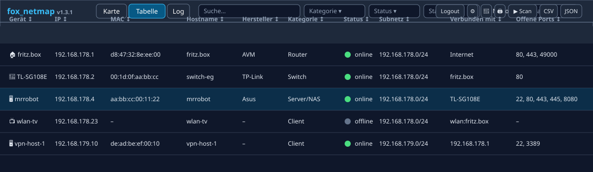

# fox_netmap — Manuel utilisateur

Version 1.3.x · novembre 2026

> Langues : [Deutsch](02-benutzerhandbuch.md) · [English](02-benutzerhandbuch.en.md) · [Français](02-benutzerhandbuch.fr.md) · [Español](02-benutzerhandbuch.es.md) · [Italiano](02-benutzerhandbuch.it.md) · [Português](02-benutzerhandbuch.pt.md)

fox_netmap est une carte réseau interactive et consultable pour votre réseau domestique :
jusqu'à ~200 appareils sur plusieurs sous-réseaux/VLAN, avec la topologie (« connecté à »),
les ports ouverts, l'historique, des alarmes et des exports (JSON/CSV/impression PDF).
Les données sont persistantes en SQLite ; les scans sont cycliques ou manuels.

> Les images de ce manuel (`docs/screenshots/*.svg`) sont des illustrations schématiques de
> l'interface réelle (thème sombre) — la structure et les éléments correspondent 1:1 à l'application.

**Sommaire**

1. [Démarrage rapide](#1-démarrage-rapide)
2. [L'interface](#2-linterface)
3. [Utiliser la carte](#3-utiliser-la-carte)
4. [Tableau](#4-tableau)
5. [Vue Journal](#5-vue-journal)
6. [Détails d'un appareil](#6-détails-dun-appareil)
7. [Recherche & filtres](#7-recherche--filtres)
8. [Paramètres](#8-paramètres)
9. [Intégration (embed, lecture seule)](#9-intégration-embed-lecture-seule)
10. [Exports](#10-exports)
11. [Scanner & modèle de données](#11-scanner--modèle-de-données)
12. [Topologie (« connecté à »)](#12-topologie-connecté-à)
13. [Plusieurs sites & IPv6](#13-plusieurs-sites--ipv6)
14. [Sécurité](#14-sécurité)
15. [Exploitation & déploiement](#15-exploitation--déploiement)
16. [API REST (aperçu)](#16-api-rest-aperçu)
17. [Dépannage](#17-dépannage)
18. [Accessibilité](#18-accessibilité)
19. [Glossaire](#19-glossaire)

---

## 1. Démarrage rapide

**Prérequis :** Docker + Docker Compose sur l'hôte (le scanner a besoin de `network_mode: host`
pour que ARP/ping fonctionnent sur le vrai réseau).

```bash
git clone https://github.com/KaiDeWitzka/fox_netmap.git
cd fox_netmap
# optionnel : créer un .env, p. ex.
#   NETZ_SUBNETS=192.168.178.0/24,192.168.179.0/24
#   NETZ_FRITZ_URL=http://192.168.178.1:49000
#   NETZ_FRITZ_USER=…   NETZ_FRITZ_PASS=…
docker compose up -d --build
```

- Interface web : **http://localhost:8399**
- Au premier démarrage avec `NETZ_AUTH_PASS` vide, un mot de passe aléatoire est généré une fois et enregistré dans
  `./data/initial-admin-password.txt` (lisible par le propriétaire uniquement, pas dans les logs). Login par défaut : `admin`.
  Définir ensuite `NETZ_AUTH_PASS` – le fichier est alors supprimé automatiquement.
- Le premier scan démarre automatiquement après `NETZ_SCAN_INTERVAL` (900 s par défaut) ou
  immédiatement via **▶ Scan** dans l'en-tête.
- Les données sont dans le volume `./data` (SQLite `netmap.db`, log `netmap.log`, exports) et
  survivent à `docker compose up -d --build` (recréation). **`down -v` supprime les données !**

> Après chaque mise à jour du code, toujours exécuter `docker compose up -d --build`.

---

## 2. L'interface


L'en-tête contient (de gauche à droite) : logo/version, navigation **Carte / Tableau / Journal**,
recherche, filtres (catégorie, état, site), **En ligne uniquement**, choix de la disposition,
exports (JSON/CSV), **▶ Scan**, impression (PDF), thème (🌙/☀), **⚙ Paramètres**, déconnexion.

Un clic sur un appareil (ou ⚙) ouvre le panneau latéral à droite avec les onglets
**Détails** et **Paramètres**.

---

## 3. Utiliser la carte

- **Zoom/pan :** la molette zoome, tirer le fond déplace la vue. Les positions des appareils sont
  enregistrées (glisser un nœud est persisté via l'API).
- **Clic sur un appareil :** projecteur — l'appareil et ses connexions directes sont mis en
  évidence, le reste est atténué ; les détails s'ouvrent à droite. Nouveau clic sur le fond pour effacer.
- **« En ligne uniquement » :** masque les appareils hors ligne (persisté en localStorage).
- **« Grouper les sous-réseaux » :** les appareils sont regroupés par sous-réseau dans un cadre
  (étiquette `sous-réseau · site (nombre)`). Les arêtes restent entre les appareils,
  même entre sous-réseaux.
- **Replier/déplier les enfants :** dans le panneau de détails d'un routeur/switch, un bouton
  masque tous les appareils directement connectés ; le nœud affiche alors `(+N)`.
- **Disposition :** `auto` (défaut) dispose la carte en arbre selon la topologie : Internet en haut, puis
  le routeur, les switchs/répéteurs et les terminaux. Les nombreux terminaux d'un même nœud sont placés en
  grille compacte en dessous ; les appareils sans parent sont sous l'arbre. Si des positions sont enregistrées
  pour tous les appareils (glisser), `auto` les utilise. Autres : `tree` (toujours arbre), `force` (physique),
  `concentric`, `circle`, `grid`. **Réinitialiser** efface les positions enregistrées.
- **Allègement automatique :** nœuds compacts (20 px), arêtes fines (WLAN en pointillé, accès Internet plus
  épais) ; étiquettes pleinement visibles à partir du zoom ≥ 0,85 (en dessous, seulement les concentrateurs :
  routeur/switch/passerelle/internet) ; au-delà de 25 appareils, les groupes de sous-réseaux s'activent
  automatiquement ; « En ligne uniquement » est actif par défaut (modifiable).
- Nœuds virtuels : **🌐 Internet** (avec l'IP WAN via TR-064, sinon « ? »), **🏠 Passerelle**
  (si la passerelle n'est pas dans la liste) et **📶 wlan:…** pour les appareils WLAN sans nœud propre.
- Emoji de catégorie sur les nœuds : 🏠 Routeur · 🔀 Switch · 🖥 Serveur/NAS · 💻 Client · 🖨 Imprimante ·
  💡 Domotique/IoT · ❓ Inconnu.

---

## 4. Tableau



- **Réordonner les colonnes :** glisser une cellule d'en-tête — l'ordre est enregistré (localStorage).
- **Largeur des colonnes :** glisser le séparateur dans l'en-tête — la largeur est enregistrée.
- **Tri :** clic sur un en-tête de colonne.
- **Modifier la catégorie en ligne :** liste déroulante dans la colonne catégorie.
- Hôte/IP avec des ports d'interface web (80/8080/443/8443) rendus comme liens cliquables
  (http + https, IPv6 entre `[…]`).
- Les appareils sans MAC (p. ex. IP seules du sous-réseau VPN) affichent « – » comme MAC.

---

## 5. Vue Journal


La vue **Journal** afficheLes niveaux sont colorés (INFO bleu, WARN ambre, ERROR rouge).  `netmap.log` (rotation, 1 Mo × 3) avec rafraîchissement auto toutes
les 5 s, filtre par niveau, et téléchargement du fichier complet. Idem via `/api/logs` et
`/api/logs/download`.

---

## 6. Détails d'un appareil

À droite, onglet **Détails** : catégorie (modifiable), IP/MAC/nom d'hôte/fabricant (OUI), état,
sous-réseau, site, source(s) du scan (p. ex. `arp,tr064`), « connecté à » (choix manuel, vide =
auto), ports ouverts avec noms de service, note, historique (en ligne/hors ligne/ports) et
événements. **Enregistrer** persiste catégorie/note/connexion manuelle.

---

## 7. Recherche & filtres

- **Recherche :** cherche dans nom d'hôte, IP, MAC, fabricant, note (filtre en direct).
- **Filtres :** catégorie, état (en ligne/hors ligne), site — combinables, s'appliquent à la carte
  et au tableau.
- **En ligne uniquement :** bascule rapide dans l'en-tête.

---

## 8. Paramètres


Tout ce qui est modifié ici prend effet **au prochain scan sans redémarrer le conteneur**
(les valeurs env de la compose restent les défauts pour une installation neuve ; vide = défaut env).

| Champ | Équivalent env | Signification |
|---|---|---|
| Sous-réseaux | `NETZ_SUBNETS` | séparés par des virgules, CIDR IPv4 et IPv6 (p. ex. `192.168.178.0/24, 2003:db8::/64`) |
| Intervalle / timeout de scan | `NETZ_SCAN_INTERVAL` / `NETZ_SCAN_TIMEOUT` | secondes ; intervalle 30–86400 |
| Portée des ports / ports perso | `NETZ_PORT_TOP` / `NETZ_PORTS` | top N (0 = tous) ou liste perso `80,443,…` |
| SNMP activé / switches / communauté | `NETZ_SNMP_ENABLED` / `_SWITCHES` / `_COMMUNITY` | table CAM + LLDP des switches (161/udp) |
| TR-064 appareil principal / autres points / utilisateur / mot de passe | `NETZ_FRITZ_URL` / `_URLS` / `_USER` / `_PASS` | URL ou `hôte:port` ; répéteurs comme points supplémentaires ; le mot de passe est **write-only** (jamais renvoyé par GET, vide = inchangé) |
| URL d'alarme (webhook/Gotify/Ntfy) | `NETZ_NOTIFY_*` | `http(s)://…` ; les tokens restent env-only (`NETZ_NOTIFY_*_TOKEN`) |
| Liste blanche | `NETZ_ALARM_WHITELIST` | MAC/IP qui ne déclenchent pas d'alarme « nouvel appareil » |
| Sites | `NETZ_SITES` | `Nom:sous-réseau; …` p. ex. `Maison:192.168.178.0/24; Remote:192.168.179.0/24` |
| Historique / rétention | `NETZ_HISTORY_HOURS` / `NETZ_DEVICE_RETENTION_DAYS` | historique en heures ; supprimer les appareils hors ligne après N jours (0 = jamais) |
| Auto-export / intervalle / dossier | `NETZ_AUTO_EXPORT` / `_INTERVAL_HOURS` / `_DIR` | JSON+CSV auto ; intervalle en h (0 = après chaque scan) |
| mDNS | `NETZ_MDNS_ENABLED` | noms d'hôte via mDNS PTR en secours (+ DNS-SD, v1.6.0) |
| Repli OUI en ligne / max de requêtes par scan / URL d'API | `NETZ_OUI_ONLINE_ENABLED` / `_MAX` / `_URL` | fabricant des MAC inconnues recherché en ligne (défaut `https://api.macvendors.com`), **désactivé par défaut** (protection des données : les préfixes MAC sont envoyés à un tiers), mis en cache en BDD |
| Login activé | `NETZ_AUTH_ENABLED` | login par session on/off (user/pass restent env-only) |
| Thème / langue | `NETZ_THEME` / `NETZ_LANG` | dark/light ; de/en/fr/es/it/pt |

**Validation :** les entrées invalides (p. ex. `pas-une-ip` comme sous-réseau, port `abc`,
webhook sans `https://`) sont signalées immédiatement dans le frontend et rejetées par le
backend avec HTTP 422.

---

## 9. Intégration (embed, lecture seule)

Dans les Paramètres (**Jetons d'intégration**) créer un jeton — avec date d'expiration et filtres
optionnels (sous-réseaux/catégories). Intégration via :

```html
<iframe src="https://netmap.example.com/embed?token=ABC123&lang=fr" width="100%" height="600"></iframe>
```

L'embed est en lecture seule (pas d'édition, pas de paramètres), respecte les filtres du jeton
et peut être ajusté avec `?theme=dark|light` et `?lang=…`.

---

## 10. Exports

- **JSON / CSV** dans l'en-tête : export complet de tous les appareils (ports, historique,
  connexions, sites). CSV avec séparateur au choix (`/api/export/csv?sep=;`).
- **Imprimer → PDF :** vue optimisée pour l'impression (navigateur « Enregistrer en PDF »).
- **Auto-export :**
- **PDF (côté serveur) :** bouton **PDF** dans l'en-tête — capture de la carte (PNG) + tableau des appareils en vrai PDF via `POST /api/export/pdf`  (aussi avec un jeton, filtres via paramètres de requête). Orientation portrait/paysage via la liste à côté du bouton (mémorisée, `orientation` dans le corps POST) ; les longues cellules sont coupées proprement au lieu de se chevaucher. à activer dans les Paramètres ; écrit JSON+CSV après chaque intervalle dans
  le dossier d'export (relatif au volume de données, défaut `exports`).

---

## 11. Scanner & modèle de données

Deux services compose partagent le volume `./data` :

- `netmap` — web/API (port 8399)
- `netmap-scanner` — `command: ["scanner"]`, `network_mode: host`, caps `NET_RAW`

**Sources par scan (priorité de fusion) :** balayage ping + ARP (`/proc/net/arp`) + sonde TCP
(80/443/22/445/8080) pour les hôtes bloqués en ICMP (p. ex. sous-réseau VPN) → TR-064 (appareil
principal + `NETZ_FRITZ_URLS`, fusion par IP, répéteurs via `tr064_parent`) → SNMP (CAM/LLDP)
→ mDNS/DNS. Conflits de MAC : la MAC ARP gagne. Les doublons (même IP) sont fusionnés au démarrage.

**Cycle :** toutes les 900 s par défaut + déclenchement manuel (▶ Scan). Chaque scan écrit
l'historique (`device_history`), les événements (`device_events` : en ligne/hors ligne/ports
modifiés/nouveau) et déclenche des alarmes (webhook/Gotify/Ntfy pour un nouvel appareil — sauf
liste blanche).

**Rétention :** les appareils hors ligne sont supprimés après `NETZ_DEVICE_RETENTION_DAYS`
(30 par défaut, 0 = jamais).

**Catégories d'appareils (depuis v1.6.0) :** Routeur, Répéteur/AP, Switch, Serveur/NAS, Client, Appareil mobile,
Multimédia, Imprimante, Domotique/IoT, Inconnu. Chaque signal donne des points, le total le plus élevé l'emporte :
passerelle (100) > rôle mesh FRITZ!Box (50) > modèle mDNS, p. ex. `iPhone14,2` (8) > nom d'hôte (6) >
service mDNS, p. ex. `_ipp._tcp` (4) > fabricant OUI (3) > ports ouverts (1–5) > adresse Wi-Fi privée (1).
Le port 53 seul ne fait plus d'un appareil un routeur ; SMB (445) seul compte comme client. Quelques ports élevés
sans ambiguïté sont testés en plus (62078 iOS, 8009 Google Cast, 1400 Sonos, 8006 Proxmox), sauf liste propre dans
`NETZ_PORTS`. Le panneau de détails indique sous **Détecté via** le signal décisif. Une catégorie définie
manuellement prime toujours. La recherche de services mDNS est une seule requête locale (`NETZ_MDNS_ENABLED`).

---

## 12. Topologie (« connecté à »)

Priorité : **manuel** (panneau de détails) > **SNMP** (CAM+LLDP) > **Mesh FRITZ!Box** (TR-064) > **TR-064** (répéteurs) >
**WLAN** (`wlan:…` si TR-064 marque l'hôte comme WLAN) > **passerelle**.
Le type de connexion `lan`/`wlan`/`plc` est aussi enregistré. Les arêtes vont du parent vers l'appareil
(base de la disposition en arbre). Si « connecté à » est une IP ou un nom d'hôte, il est associé à l'appareil
correspondant ; un nœud passerelle virtuel n'est créé que si aucun n'existe.

**Mesh FRITZ!Box (depuis v1.6.0) :** via TR-064 (`X_AVM-DE_GetMeshListPath`), fox_netmap lit la topologie mesh de
la box : quel appareil est relié à quel répéteur ou port LAN, en LAN ou WLAN (bande). Le panneau de détails affiche
le port, p. ex. `WLAN · 5 GHz` ou `LAN · LAN 1`. Selon AVM, l'utilisateur TR-064 a besoin du droit
« App » ou « Phone ». Désactivation : `NETZ_FRITZ_MESH=false`. La liste n'est chargée que depuis le réseau local (chemin
relatif, sans redirection, 5 Mo max.) ; l'ID de session n'est jamais journalisé.
**Heuristique switch :** un switch non administrable est invisible pour la box. Si plusieurs appareils sont vus sur
un port LAN et qu'un seul est un switch, les autres lui sont rattachés. Avec deux switches sur le même port, tout
reste au routeur ; utilisez alors l'affectation manuelle.

---

## 13. Plusieurs sites & IPv6

Exemple (site VPN comme dans votre propre réseau) :

```env
NETZ_SUBNETS=192.168.178.0/24,192.168.179.0/24
NETZ_SITES=Maison:192.168.178.0/24; Remote:192.168.179.0/24
```

→ filtre de site dans l'en-tête, colonne « Site » dans le tableau, étiquette de site dans les
groupes de sous-réseaux, champ `site` dans les exports. Le sous-réseau distant est découvert
par sonde TCP même si ICMP est bloqué.

IPv6 : ajouter simplement un CIDR v6 aux sous-réseaux ; découverte dans les grands réseaux via
NDP + ping de la passerelle, plus un balayage pour les petits ; passerelle-v6 pour la topologie ;
liens web sous la forme `[2003:db8::10]:8080`.

---

## 14. Sécurité

- **Depuis la v1.5.0 :** hachage PBKDF2-SHA256 avec 600 000 itérations (les anciens hachages sont convertis automatiquement à la prochaine connexion) ; les sessions expirées sont nettoyées ; cookie de session `Secure` en HTTPS (`NETZ_COOKIE_SECURE=auto|true|false`) ; recherche en ligne du fabricant désactivée par défaut.
- **Depuis la v1.4.1 :** toutes les données réseau et utilisateur sont encodées en HTML avant affichage (protection XSS) ; en-têtes de sécurité (CSP, `X-Frame-Options`, `Referrer-Policy: no-referrer`) sur toutes les réponses ; blocage de la connexion pendant 15 minutes après 5 échecs (IP+utilisateur) ou 20 (IP) (HTTP 429).
- `NETZ_EMBED_ANCESTORS` définit les sites autorisés à intégrer `/embed` dans une iframe (par défaut `*` ; recommandé : indiquer vos propres domaines).
- Détails (en allemand) : [concept de sécurité](03-sicherheit.md).
- Login par session (PBKDF2, cookie `fox_session`), activé par défaut ; `NETZ_AUTH_ENABLED=false` le désactive.
- `NETZ_AUTH_USER`/`NETZ_AUTH_PASS` sont env-only ; mot de passe vide → mot de passe initial aléatoire dans `./data/initial-admin-password.txt` (plus dans les logs depuis la v1.5.0).
- `GET /api/settings` ne renvoie **aucun secret** (couvert par test) : ni `auth_pass`, ni
  `fritz_pass`, ni `notify_*_token`. Le mot de passe TR-064 est write-only dans les Paramètres.
- Jetons d'embed : expirables, filtrables, lecture seule ; les chemins API protégés par jeton
  sont uniquement `/api/devices`, `/api/device/…`, `/api/export/…`.
- Le scanner tourne avec des caps minimales (`NET_RAW`), en lecture seule sur le réseau.
- **Protection des données :** les données collectées, stockées et envoyées à l'extérieur sont décrites dans la [notice de confidentialité](04-datenschutz.md) (en allemand). Depuis la v1.5.2, un appareil peut être supprimé dans le panneau de détails via **Supprimer l'appareil**, avec son historique, ses ports et ses événements (avec confirmation). S'il est toujours sur le réseau, il réapparaît au prochain scan.

---

## 15. Exploitation & déploiement

```bash
docker compose up -d --build          # après chaque mise à jour (recréation, données conservées)
docker compose logs -f netmap-scanner  # logs du scanner en direct
docker compose down                    # arrêt (données conservées)
docker compose down -v                 # ATTENTION : supprime ./data (BDD, log, exports) !
```

- Santé : `GET /api/health` → `{ "status": "ok", "version": "1.5.2" }`
- Depuis la v1.5.0, les conteneurs **ne tournent plus en root** mais avec l'UID/GID `10001`. L'interface web n'a aucune capability et un système de fichiers racine en lecture seule ; le scanner ne garde que `NET_RAW` pour ping.
- Au premier démarrage après la mise à jour, le conteneur attribue automatiquement les fichiers existants de `./data` à l'UID 10001. Sur l'hôte, utiliser `sudo` pour les lire ou ajouter votre utilisateur à un groupe de GID 10001.
- Healthcheck Docker : `docker compose ps` affiche `healthy`/`unhealthy` (web : `/api/health`, scanner : boucle de scan active).
- Volumes : `./data:/data` (SQLite WAL, `netmap.log` en rotation, `exports/`)
- Ports : `NETMAP_PORT` (hôte) → 8399 (conteneur)
- Fuseau horaire : `TZ=Europe/Berlin`
- Releases : les tags SemVer `vX.Y.Z` passent par `release.yml` (ruff + pytest + tests UI) et
  créent automatiquement une release GitHub.
- Image prête à l'emploi (depuis v1.5.1) : `docker pull ghcr.io/kaidewitzka/fox_netmap:latest` (amd64/arm64). Tant que le dépôt est privé, exécuter d'abord `docker login ghcr.io` avec un jeton (`read:packages`). Dans le Compose, remplacer `build: .` par `image: ghcr.io/kaidewitzka/fox_netmap:<version>`. Chaque image est analysée avec Trivy ; le SBOM et le rapport sont joints à la release GitHub.

---

## 16. API REST (aperçu)

| Point | Objectif |
|---|---|
| `GET /api/health` | santé + version (public) |
| `GET /api/devices?q=&category=&status=&subnet=&site=` | liste des appareils, filtrable |
| `PATCH /api/device/{mac}` | modifier catégorie/note/« connecté à »/position |
| `DELETE /api/device/{mac}` | supprimer l'appareil avec historique, ports et événements (connexion requise) |
| `GET /api/device/{mac}` | détails (ports/historique/événements) |
| `POST /api/scan` · `GET /api/scan/status` | déclencher un scan / état |
| `GET /api/settings` · `PATCH /api/settings` | lire les paramètres (sans secrets) / modifier (422 si invalide) |
| `GET/POST /api/tokens` · `DELETE /api/tokens/{id}` | gérer les jetons d'embed |
| `GET /api/export/json` · `GET /api/export/csv?sep=,` | exports |
| `GET /api/logs?lines=200&level=WARNING` · `GET /api/logs/download` | journal |
| `GET /api/meta` | IP WAN, passerelle, version, sous-réseaux (public) |
| `GET /api/sites` · `GET /api/categories` | sites / catégories (public) |
| `POST /api/layout/reset` | effacer les positions de nœuds enregistrées |

Auth : cookie de session après `POST /api/login` ; jeton d'embed à la place de la session pour
les chemins à jeton.

---

## 17. Dépannage

| Symptôme | Cause / solution |
|---|---|
| « Trop de tentatives échouées » à la connexion | Blocage actif (HTTP 429). Attendre 15 minutes ou redémarrer le conteneur (`docker compose restart netmap`). |
| L'intégration ne s'affiche pas dans l'iframe | `NETZ_EMBED_ANCESTORS` ne contient pas le site intégrant. Ajouter le domaine puis `docker compose up -d`. |
| Appareil absent du sous-réseau VPN | ICMP bloqué → la sonde TCP prend le relais automatiquement ; visible dans le journal (`WARN … TCP probe ok`). Ajouter le sous-réseau dans les Paramètres. |
| Erreurs TR-064 dans le journal | le repli https→http est automatique ; vérifier URL/utilisateur/mot de passe dans les Paramètres. Les fautes SOAP sont journalisées en clair. |
| Switch sans voisins | TL-SG108E etc. sans SNMP → port 80 uniquement ; définir la topologie manuellement dans le panneau de détails. |
| Appareil « en double » | même IP avec deux MAC → la MAC ARP gagne, le reste est dédupliqué au démarrage. |
| Anciens appareils qui disparaissent | rétention active (30 jours hors ligne par défaut) — passer à `0` = jamais dans les Paramètres. |
| Carte illisible | activer « Grouper les sous-réseaux » + replier les enfants du routeur/switch + essayer `tree`/`grid`. |
| Login oublié | définir `NETZ_AUTH_PASS` dans compose/.env puis `docker compose up -d --build`. |
| Tout recommencer | `docker compose down -v && docker compose up -d --build` — supprime la BDD ! Sauvegarder les exports avant. |

L'onglet **Journal** + `docker compose logs netmap-scanner` montrent chaque étape de scan.

---

## 18. Accessibilité

- Navigation clavier : Tab dans l'en-tête/les vues, Entrée active ; anneaux de focus visibles.
- Contrastes vérifiés en thème sombre/clair ; l'état est aussi textuel (« online/offline »), pas seulement en couleur.
- aria-labels sur les boutons icônes, région live pour les messages d'état.
- La conformité BITV 2.1 complète est l'objectif — retours bienvenus (issue dans le dépôt).
- **Réduire les animations (depuis la v1.5.2) :** si « réduire les animations » est activé dans le système (`prefers-reduced-motion`), fox_netmap n'affiche ni animation ni transition ; un scan en cours est signalé par un point fixe et un texte. Sinon, le point ne pulse que trois fois (moins de 5 secondes) puis reste fixe (WCAG 2.2.2, 2.3.3). La carte est toujours construite sans animation.
- L'état du scan n'est annoncé aux lecteurs d'écran que lorsqu'il change réellement.

---

## 19. Glossaire

- **OUI** — identification du fabricant via les 3 premiers octets de la MAC (BDD locale `app/data/oui_seed.txt`).
- **TR-064** — interface SOAP AVM de la FRITZ!Box (liste des hôtes, IP WAN, clients WLAN).
- **Table CAM** — table MAC-port du switch via SNMP (Q-BRIDGE/BRIDGE-MIB).
- **LLDP** — découverte des voisins via SNMP (LLDP-MIB), p. ex. `lldpRemChassisId`.
- **Rétention** — suppression automatique des appareils hors ligne depuis longtemps.
- **Projecteur (spotlight)** — mise en évidence d'un appareil + ses connexions directes sur la carte.
- **Site** — un nom pour un sous-réseau (`NETZ_SITES`), p. ex. « Remote » pour le réseau VPN.

---

*Questions ou bugs ? Ouvrir une issue dans `KaiDeWitzka/fox_netmap` — les exigences sont dans
`docs/01-anforderungen.md`.*
