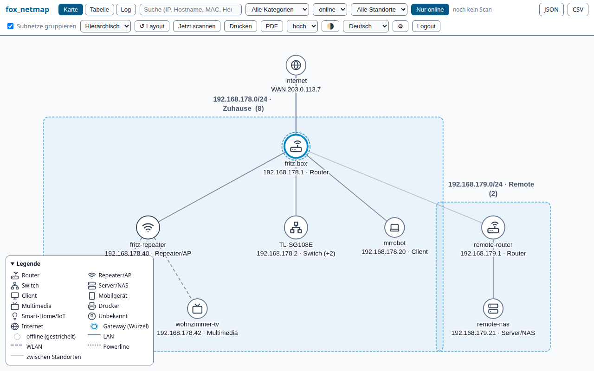
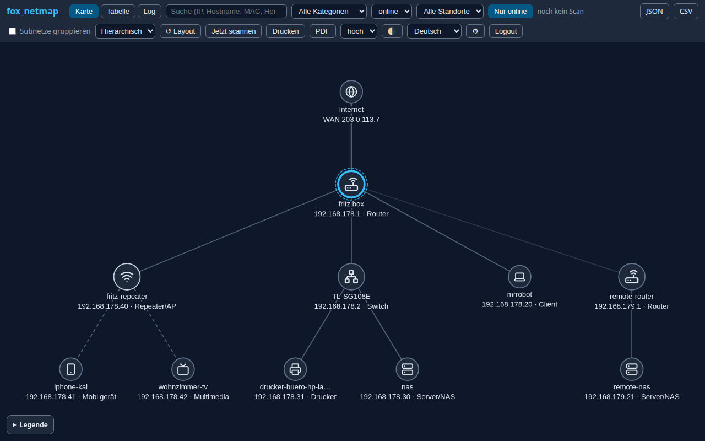
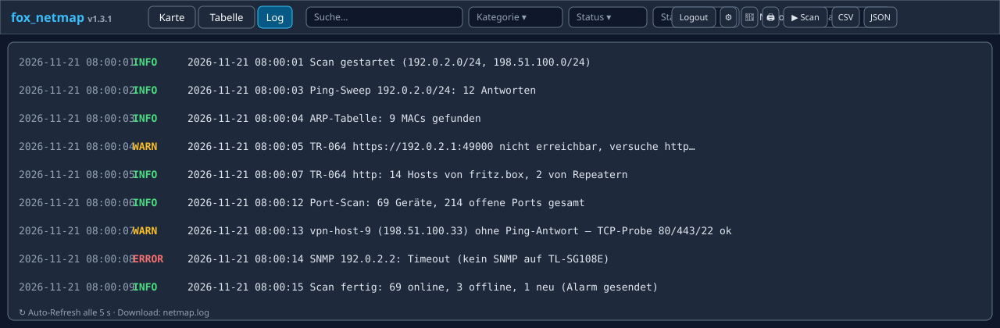
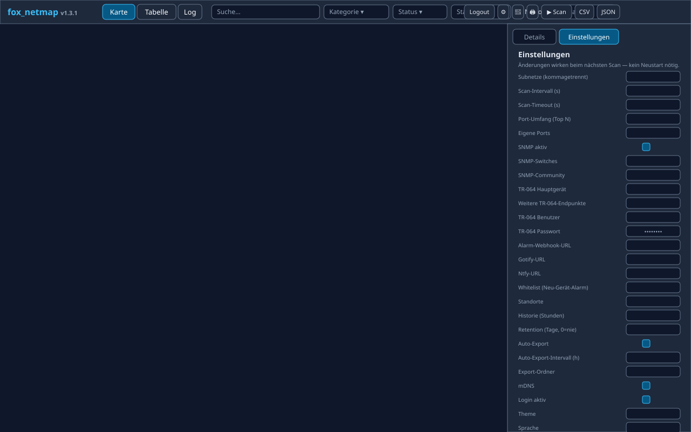

# fox_netmap — Manuale utente

Versione 1.6.1 · novembre 2026

> Lingue: [Deutsch](02-benutzerhandbuch.md) · [English](02-benutzerhandbuch.en.md) · [Français](02-benutzerhandbuch.fr.md) · [Español](02-benutzerhandbuch.es.md) · [Italiano](02-benutzerhandbuch.it.md) · [Português](02-benutzerhandbuch.pt.md)

fox_netmap è una mappa di rete interattiva e consultabile per la rete domestica: fino a ~200
dispositivi su più sottoreti/VLAN, con topologia («collegato a»), porte aperte, cronologia,
allarmi ed esportazioni (JSON/CSV/stampa PDF). I dati sono persistenti in SQLite; le scansioni
sono cicliche o manuali.

> Le immagini della mappa `docs/screenshots/01-karte-hell.png` e `01-karte-dunkel.png` sono catture reali
> della v1.6.1 con dati di prova. Le altre immagini (`*.svg`) sono illustrazioni schematiche dell'interfaccia
> (tema scuro); struttura ed elementi corrispondono all'app.

**Indice**

1. [Avvio rapido](#1-avvio-rapido)
2. [L'interfaccia](#2-linterfaccia)
3. [Usare la mappa](#3-usare-la-mappa)
4. [Tabella](#4-tabella)
5. [Vista Log](#5-vista-log)
6. [Dettagli del dispositivo](#6-dettagli-del-dispositivo)
7. [Ricerca e filtri](#7-ricerca-e-filtri)
8. [Impostazioni](#8-impostazioni)
9. [Incorporamento (embed, sola lettura)](#9-incorporamento-embed-sola-lettura)
10. [Esportazioni](#10-esportazioni)
11. [Scanner e modello dati](#11-scanner-e-modello-dati)
12. [Topologia («collegato a»)](#12-topologia-collegato-a)
13. [Più siti e IPv6](#13-più-siti-e-ipv6)
14. [Sicurezza](#14-sicurezza)
15. [Esercizio e distribuzione](#15-esercizio-e-distribuzione)
16. [API REST (panoramica)](#16-api-rest-panoramica)
17. [Risoluzione dei problemi](#17-risoluzione-dei-problemi)
18. [Accessibilità](#18-accessibilità)
19. [Glossario](#19-glossario)

---

## 1. Avvio rapido

**Requisiti:** Docker + Docker Compose sull'host (lo scanner necessita di `network_mode: host`
perché ARP/ping funzionino sulla rete reale).

```bash
git clone https://github.com/KaiDeWitzka/fox_netmap.git
cd fox_netmap
# opzionale: creare .env, p. es.
#   NETZ_SUBNETS=192.168.178.0/24,192.168.179.0/24
#   NETZ_FRITZ_URL=http://192.168.178.1:49000
#   NETZ_FRITZ_USER=…   NETZ_FRITZ_PASS=…
docker compose up -d --build
```

- Interfaccia web: **http://localhost:8399**
- Al primo avvio con `NETZ_AUTH_PASS` vuoto viene generata una volta una password casuale e salvata in
  `./data/initial-admin-password.txt` (leggibile solo dal proprietario, non nei log). Login predefinito: `admin`.
  Poi impostare `NETZ_AUTH_PASS`: il file viene eliminato automaticamente.
- La prima scansione parte automaticamente dopo `NETZ_SCAN_INTERVAL` (900 s predefiniti) oppure
  subito tramite **▶ Scan** nell'intestazione.
- I dati sono nel volume `./data` (SQLite `netmap.db`, log `netmap.log`, esportazioni) e
  sopravvivono a `docker compose up -d --build` (ricreazione). **`down -v` elimina i dati!**

> Dopo ogni aggiornamento del codice eseguire sempre `docker compose up -d --build`.

---

## 2. L'interfaccia





Vista schematica con pannello dettagli: [01-karte.svg](screenshots/01-karte.svg)

L'intestazione contiene (da sx a dx): logo con **numero di versione** (da `/api/meta`, cambia a ogni release), navigazione **Mappa / Tabella / Log**,
ricerca, filtri (categoria, stato, sito), **Solo online**, selettore del layout, esportazioni
(JSON/CSV), **▶ Scan**, stampa (PDF), tema (🌙/☀), **⚙ Impostazioni**, logout.

Cliccando su un dispositivo (o su ⚙) si apre il pannello laterale a destra con le schede
**Dettagli** e **Impostazioni**.

---

## 3. Usare la mappa

- **Zoom/pan:** la rotella zooma, trascinare lo sfondo sposta. Le posizioni dei dispositivi vengono
  salvate (trascinare un nodo è persistente via API).
- **Clic su un dispositivo:** spotlight — il dispositivo e i suoi collegamenti diretti vengono
  evidenziati, il resto si attenua; i dettagli si aprono a destra. Nuovo clic sullo sfondo per
  annullare.
- **«Solo online»:** nasconde i dispositivi offline (persistito in localStorage).
- **«Raggruppa sottoreti»:** i dispositivi vengono raggruppati per sottorete in una cornice
  (etichetta `sottorete · sito (numero)`). Gli archi restano tra i dispositivi, anche
  tra sottoreti.
- **Comprimi/espandi figli:** nel pannello dettagli di router/switch, un pulsante nasconde tutti
  i dispositivi collegati direttamente; il nodo mostra poi `(+N)`.
- **Layout:** `auto` (predefinito) dispone la mappa ad albero secondo la topologia: Internet in alto, sotto
  router, switch/ripetitori e dispositivi finali. Molti dispositivi finali di un nodo stanno in una griglia
  compatta sotto di esso; i dispositivi senza genitore stanno sotto l'albero. Se sono salvate posizioni per tutti
  i dispositivi (trascinando), `auto` le usa. Altri: `tree` (sempre albero), `force` (fisica), `concentric`,
  `circle`, `grid`. **Ripristina** cancella le posizioni salvate.
- **Nodi (dalla v1.6.1):** cerchio neutro con simbolo di categoria (simboli Lucide, vedi `THIRD_PARTY.md`)
  al posto di colori ed emoji. Router, switch, ripetitore/AP, server/NAS e Internet misurano 40 px, i
  dispositivi finali 34 px. Per i client la mappa distingue portatile, tablet e console in base al nome e al
  motivo di rilevamento.
- **Etichetta su due righe:** riga 1 il nome (abbreviato con «…» da 20 caratteri; il nome completo appare
  come tooltip al passaggio del mouse), riga 2 `IP · categoria`, con `(+N)` per i figli nascosti e
  `· offline` per i dispositivi offline. Il nodo Internet mostra `Internet` e `WAN <IP>` («?» senza TR-064).
  Entrambe le righe hanno lo stesso colore perché la libreria Cytoscape non prevede un colore per riga.
- **Gateway come radice:** solo il dispositivo con l'IP del gateway (TR-064 o routing) riceve un anello
  marcato nel colore d'accento con anello esterno tratteggiato. Ripetitori/AP hanno un bordo chiaro.
- **Offline:** corpo e simbolo attenuati, bordo tratteggiato; l'etichetta resta leggibile e indica
  «offline», quindi l'informazione non dipende dal colore.
- **Archi:** linee dritte, LAN continua, WLAN tratteggiata, powerline punteggiata. I collegamenti tra sedi
  diverse sono più tenui. L'accesso a Internet è un po' più marcato.
- **Legenda:** in basso a sinistra, richiudibile (stato salvato nel browser, chiusa per impostazione
  predefinita). Mostra tutti i simboli con la categoria, l'anello del gateway, offline e i tipi di linea.
- **Pulizia automatica:** etichette complete da zoom ≥ 0,85 (sotto solo gli hub: router/switch/gateway/Internet),
  il testo molto piccolo non viene disegnato; oltre 25 dispositivi i gruppi di sottorete si attivano da soli;
  «Solo online» è attivo per impostazione predefinita.
- Nodi virtuali: **Internet** (con IP WAN), **Gateway** (se il gateway non è nell'elenco) e **wlan:…** per
  dispositivi WLAN senza nodo proprio.
- **Tabella e stampa:** la cella categoria mostra lo stesso simbolo della mappa più il testo. I filtri e la
  selezione della categoria sono elenchi nativi e mostrano solo testo.

---

## 4. Tabella


- **Riordina colonne:** trascina una cella di intestazione — l'ordine è salvato (localStorage).
- **Larghezza colonne:** trascina il divisore nell'intestazione — la larghezza è salvata.
- **Ordinamento:** clic su un'intestazione di colonna.
- **Cambia categoria in linea:** menu a discesa nella colonna categoria.
- Host/IP con porte di interfaccia web (80/8080/443/8443) sono resi come link cliccabili
  (http + https, IPv6 tra `[…]`).
- I dispositivi senza MAC (p. es. IP sole dalla sottorete VPN) mostrano «–» come MAC.

---

## 5. Vista Log



La vista **Log** mostraI livelli sono colorati (INFO blu, WARN ambra, ERROR rosso).  `netmap.log` (rotante, 1 MB × 3) con aggiornamento automatico ogni 5 s,
filtro per livello e download del file completo. Lo stesso è offerto da `/api/logs` e
`/api/logs/download`.

---

## 6. Dettagli del dispositivo

A destra, scheda **Dettagli**: categoria (modificabile), IP/**IPv6** (v6 via match MAC NDP da `ip -6 neigh`, colonna `ip6` in DB/JSON/CSV), MAC/hostname/produttore (OUI), stato,
sottorete, sito, fonte/i della scansione (p. es. `arp,tr064`), «collegato a» (selezionabile
manualmente, vuoto = automatico), porte aperte con nomi di servizio, nota, cronologia
(online/offline/porte) ed eventi. **Salva** persiste categoria/nota/collegamento manuale.

---

## 7. Ricerca e filtri

- **Ricerca:** cerca in hostname, IP, MAC, produttore, nota (filtro live).
- **Filtri:** categoria, stato (online/offline), sito — combinabili, si applicano a mappa e tabella.
- **Solo online:** interruttore rapido nell'intestazione.

---

## 8. Impostazioni



Tutto ciò che viene modificato qui ha effetto **alla prossima scansione senza riavviare il
contenitore** (i valori env del compose restano i predefiniti per nuove installazioni; vuoto =
predefinito env).

| Campo | Equivalente env | Significato |
|---|---|---|
| Sottoreti | `NETZ_SUBNETS` | separate da virgole, CIDR IPv4 e IPv6 (p. es. `192.168.178.0/24, 2003:db8::/64`) |
| Intervallo / timeout scansione | `NETZ_SCAN_INTERVAL` / `NETZ_SCAN_TIMEOUT` | secondi; intervallo 30–86400 |
| Ambito porte / porte proprie | `NETZ_PORT_TOP` / `NETZ_PORTS` | top N (0 = tutte) o elenco proprio `80,443,…` |
| SNMP attivo / switch / community | `NETZ_SNMP_ENABLED` / `_SWITCHES` / `_COMMUNITY` | tabella CAM + LLDP degli switch (161/udp). Community senza valore predefinito (da v1.6.0); senza community niente SNMP |
| TR-064 dispositivo principale / altri endpoint / utente / password | `NETZ_FRITZ_URL` / `_URLS` / `_USER` / `_PASS` | URL o `host:porta`; ripetitori come endpoint extra; la password è **write-only** (GET non la restituisce mai, vuoto = invariato) |
| URL allarme (webhook/Gotify/Ntfy) | `NETZ_NOTIFY_*` | `http(s)://…`; i token restano solo env (`NETZ_NOTIFY_*_TOKEN`) |
| Whitelist | `NETZ_ALARM_WHITELIST` | MAC/IP che non attivano l'allarme «nuovo dispositivo» |
| Siti | `NETZ_SITES` | `Nome:sottorete; …` p. es. `Casa:192.168.178.0/24; Remoto:192.168.179.0/24` |
| Pool indirizzi VPN | `NETZ_VPN_POOL` | Default `off` (nessuna presupposizione). `auto` = convenzione FRITZ!: ultimo ottetto ≥ 201 nella /24 del gateway; anche CIDR (`10.8.0.0/24`) e intervalli (`192.168.178.201-192.168.178.254`), separati da virgola |
| Cronologia / retention | `NETZ_HISTORY_HOURS` / `NETZ_DEVICE_RETENTION_DAYS` | cronologia in ore; elimina i dispositivi offline dopo N giorni (0 = mai) |
| Retention eventi | `NETZ_EVENT_RETENTION_DAYS` | elimina gli eventi dopo N giorni, predefinito 90 (0 = mai) |
| Auto-export / intervallo / cartella | `NETZ_AUTO_EXPORT` / `_INTERVAL_HOURS` / `_DIR` | JSON+CSV automatici; intervallo in h (0 = dopo ogni scansione) |
| mDNS | `NETZ_MDNS_ENABLED` | hostname via mDNS PTR come fallback (+ DNS-SD, v1.6.0) |
| Fallback OUI online / max lookup per scansione / URL API | `NETZ_OUI_ONLINE_ENABLED` / `_MAX` / `_URL` | produttore di MAC sconosciuti cercato online (predefinito `https://api.macvendors.com`), **disattivato per impostazione predefinita** (privacy: i prefissi MAC vengono inviati a terzi), in cache nel DB |
| Login attivo | `NETZ_AUTH_ENABLED` | login di sessione on/off (utente/password restano solo env) |
| Tema / lingua | `NETZ_THEME` / `NETZ_LANG` | dark/light; de/en/fr/es/it/pt |

**Validazione:** input non validi (p. es. `non-un-ip` come sottorete, porta `abc`, webhook senza
`https://`) vengono segnalati subito nel frontend e rifiutati dal backend con HTTP 422.

---

## 9. Incorporamento (embed, sola lettura)

In Impostazioni (**Token di incorporamento**) crea un token — opzionalmente con scadenza e filtri
(sottoreti/categorie). Incorporamento tramite:

```html
<iframe src="https://netmap.example.com/embed?token=ABC123&lang=it" width="100%" height="600"></iframe>
```

Il token viene mostrato solo subito dopo la creazione; viene salvato solo un hash (da v1.6.0). Copiarlo subito; poi l'elenco mostra solo i primi 6 caratteri.

L'embed è in sola lettura (nessuna modifica, nessuna impostazione), rispetta i filtri del token e
si può regolare con `?theme=dark|light` e `?lang=…`.

---

## 10. Esportazioni

- **JSON / CSV** nell'intestazione: esportazione completa di tutti i dispositivi (porte, cronologia,
  collegamenti, siti). CSV con separatore a scelta (`/api/export/csv?sep=;`).
- **Stampa → PDF:** vista ottimizzata per la stampa (browser «Salva come PDF»).
- **Auto-export:**
- **PDF (lato server):** pulsante **PDF** nell'intestazione — snapshot della mappa (PNG) + tabella dispositivi come PDF reale via `POST /api/export/pdf`  (anche con token, filtri tramite query param). Orientamento verticale/orizzontale selezionabile accanto al pulsante (memorizzato, `orientation` nel body POST); le celle lunghe vanno a capo invece di sovrapporsi. attivabile in Impostazioni; scrive JSON+CSV dopo ogni intervallo nella cartella
  di esportazione (relativa al volume dati, predefinita `exports`).

---

## 11. Scanner e modello dati

Due servizi compose condividono il volume `./data`:

- `netmap` — web/API (porta 8399)
- `netmap-scanner` — `command: ["scanner"]`, `network_mode: host`, cap `NET_RAW`

**Fonti per scansione (priorità di unione):** sweep ping + ARP (`/proc/net/arp`) + sonda TCP
(80/443/22/445/8080) per host bloccati in ICMP (p. es. sottorete VPN) → TR-064 (dispositivo
principale + `NETZ_FRITZ_URLS`, unione per IP, ripetitori via `tr064_parent`) → SNMP (CAM/LLDP)
→ mDNS/DNS. Conflitti MAC: vince la MAC ARP. I duplicati (stesso IP) vengono uniti all'avvio.

**Ciclo:** ogni 900 s predefiniti + avvio manuale (▶ Scan). Ogni scansione scrive cronologia
(`device_history`), eventi (`device_events`: online/offline/porte cambiate/nuovo) e attiva
allarmi (webhook/Gotify/Ntfy per nuovo dispositivo — tranne whitelist).

**Retention:** i dispositivi offline vengono eliminati dopo `NETZ_DEVICE_RETENTION_DAYS`
(30 predefiniti, 0 = mai).

**Categorie di dispositivi (da v1.6.0):** Router, Ripetitore/AP, Switch, Server/NAS, Client, Dispositivo mobile,
Multimedia, Stampante, Smart home/IoT, Sconosciuto. Ogni segnale assegna punti, vince il totale più alto:
gateway (100) > ruolo mesh FRITZ!Box (50) > modello mDNS, ad es. `iPhone14,2` (8) > nome host (6) >
servizio mDNS, ad es. `_ipp._tcp` (4) > produttore OUI (3) > porte aperte (1–5) > indirizzo Wi-Fi privato (1).
La porta 53 da sola non rende più un dispositivo un router; SMB (445) da solo conta come client. Vengono inoltre
verificate alcune porte alte univoche (62078 iOS, 8009 Google Cast, 1400 Sonos, 8006 Proxmox), salvo elenco proprio
in `NETZ_PORTS`. Il pannello dettagli mostra in **Rilevato tramite** il segnale decisivo. Una categoria manuale ha
sempre la precedenza. La ricerca dei servizi mDNS è una singola richiesta locale (`NETZ_MDNS_ENABLED`).

---

## 12. Topologia («collegato a»)

Priorità: **manuale** (pannello dettagli) > **SNMP** (CAM+LLDP) > **Mesh FRITZ!Box** (TR-064) > **TR-064** (ripetitori) >
**WLAN** (`wlan:…` se TR-064 indica l'host come WLAN) > **gateway**.
Anche il tipo di collegamento `lan`/`wlan`/`plc` è salvato. Gli archi vanno dal genitore al dispositivo
(base del layout ad albero). Se «collegato a» è un IP o un nome host, viene associato al dispositivo
corrispondente; solo se non esiste viene creato un nodo gateway virtuale.

**Assegnare più dispositivi (da v1.6.0):** nella tabella, spuntare i dispositivi nella prima colonna (la casella nell'intestazione seleziona tutti), scegliere router, switch o ripetitore in **Connesso a** e premere **Imposta**. **auto** rimuove l'assegnazione manuale. La modifica vale per tutti i dispositivi spuntati o per nessuno. Le assegnazioni che creerebbero un ciclo vengono rifiutate. Le caselle funzionano con Tab e Spazio e il risultato viene annunciato agli screen reader.

**Mesh FRITZ!Box (da v1.6.0):** tramite TR-064 (`X_AVM-DE_GetMeshListPath`) fox_netmap legge la topologia mesh
del router: quale dispositivo è collegato a quale ripetitore o porta LAN, via LAN o WLAN (banda). Il pannello
dettagli mostra la porta, ad es. `WLAN · 5 GHz` o `LAN · LAN 1`. Secondo AVM, l'utente TR-064 richiede il diritto
«App» o «Phone». Disattivare con `NETZ_FRITZ_MESH=false`. L'elenco è caricato solo dalla rete locale
(percorso relativo, senza reindirizzamenti, max 5 MB); l'ID di sessione non viene mai registrato.

**Euristica switch:** uno switch non gestito è invisibile al router. Se su una porta LAN ci sono più dispositivi e
solo uno è uno switch, gli altri vengono assegnati a esso. Con due switch sulla stessa porta resta tutto sul router;
usare allora l'assegnazione manuale.

---

## 13. Più siti e IPv6

Esempio (sito VPN come nella tua rete):

```env
NETZ_SUBNETS=192.168.178.0/24,192.168.179.0/24
NETZ_SITES=Casa:192.168.178.0/24; Remoto:192.168.179.0/24
```

→ filtro sito nell'intestazione, colonna «Sito» nella tabella, etichetta sito nei gruppi di
sottorete, campo `site` nelle esportazioni. La sottorete remota è scoperta via sonda TCP anche
se ICMP è bloccato.

IPv6: basta aggiungere un CIDR v6 alle sottoreti; scoperta nelle reti grandi via NDP + ping del
gateway, più sweep per quelle piccole; gateway-v6 per la topologia; link web come `[2003:db8::10]:8080`.

**Client VPN (es. FRITZ!Box IPSec/WireGuard .201/.202):** TR-064 segnala le connessioni VPN con tipo
di interfaccia «VPN»: questi dispositivi vengono marcati automaticamente come VPN (badge «VPN» in
tabella e mappa, riga «Connessione VPN» nel pannello dettagli, campo `vpn` in JSON/CSV/API). I peer
WireGuard non compaiono in TR-064; per quelli c'è il **pool indirizzi VPN** configurabile (es. `auto`).
I client VPN non attivano l'allarme «nuovo dispositivo», perché vanno e vengono con il tunnel.

---

## 14. Sicurezza

- **Dalla v1.5.0:** hash PBKDF2-SHA256 con 600.000 iterazioni (gli hash vecchi vengono aggiornati automaticamente al login successivo); le sessioni scadute vengono rimosse; cookie di sessione `Secure` con HTTPS (`NETZ_COOKIE_SECURE=auto|true|false`); ricerca online del produttore disattivata per impostazione predefinita.
- **Dalla v1.4.1:** tutti i dati di rete e utente vengono codificati in HTML prima della visualizzazione (protezione XSS); header di sicurezza (CSP, `X-Frame-Options`, `Referrer-Policy: no-referrer`) su tutte le risposte; blocco del login per 15 minuti dopo 5 tentativi falliti (IP+utente) o 20 (IP) (HTTP 429).
- `NETZ_EMBED_ANCESTORS` stabilisce quali siti possono incorporare `/embed` in un iframe (predefinito `*`; consigliato: indicare i propri domini).
- Dettagli (in tedesco): [concetto di sicurezza](03-sicherheit.md).
- Login di sessione (PBKDF2, cookie `fox_session`), attivo predefinito; `NETZ_AUTH_ENABLED=false` lo disattiva.
- `NETZ_AUTH_USER`/`NETZ_AUTH_PASS` sono solo env; password vuota → password iniziale casuale in `./data/initial-admin-password.txt` (dalla v1.5.0 non più nei log).
- `GET /api/settings` **non restituisce segreti** (coperto da test): né `auth_pass`, né
  `fritz_pass`, né `notify_*_token`. La password TR-064 è write-only nelle Impostazioni.
- Token di embed: con scadenza, filtrabili, sola lettura; i percorsi API protetti da token sono
  solo `/api/devices`, `/api/device/…`, `/api/export/…`.
- Lo scanner gira con cap minime (`NET_RAW`), in sola lettura verso la rete.
- **Protezione dei dati:** quali dati vengono raccolti, memorizzati e inviati all'esterno è descritto nell'[informativa sulla privacy](04-datenschutz.md) (in tedesco). Dalla v1.5.2 un dispositivo può essere eliminato nel pannello dei dettagli con **Elimina dispositivo**, insieme a cronologia, porte ed eventi (con conferma). Se è ancora in rete, ricompare alla prossima scansione.

---

## 15. Esercizio e distribuzione

```bash
docker compose up -d --build          # dopo ogni aggiornamento (ricrea, i dati restano in ./data)
docker compose logs -f netmap-scanner  # log dello scanner in tempo reale
docker compose down                    # ferma (i dati restano)
docker compose down -v                 # ATTENZIONE: elimina ./data (DB, log, esportazioni)!
```

- Salute: `GET /api/health` → `{ "status": "ok", "version": "1.5.2" }`
- Dalla v1.5.0 i container **non girano più come root**, ma con UID/GID `10001`. L'interfaccia web non ha capability e ha un file system root in sola lettura; lo scanner mantiene solo `NET_RAW` per ping.
- Al primo avvio dopo l'aggiornamento il container assegna automaticamente i file esistenti in `./data` all'UID 10001. Sull'host usare `sudo` per leggerli o aggiungere il proprio utente a un gruppo con GID 10001.
- Healthcheck Docker: `docker compose ps` mostra `healthy`/`unhealthy` (web: `/api/health`, scanner: ciclo di scansione attivo).
- Volumi: `./data:/data` (SQLite WAL, `netmap.log` rotante, `exports/`)
- Porte: `NETMAP_PORT` (host) → 8399 (contenitore)
- Fuso orario: `TZ=Europe/Berlin`
- Release: i tag SemVer `vX.Y.Z` passano da `release.yml` (ruff + pytest + test UI) e creano
  automaticamente una release GitHub.
- Immagine pronta (dalla v1.5.1): `docker pull ghcr.io/kaidewitzka/fox_netmap:latest` (amd64/arm64). Finché il repository è privato, eseguire prima `docker login ghcr.io` con un token (`read:packages`). Nel Compose sostituire `build: .` con `image: ghcr.io/kaidewitzka/fox_netmap:<versione>`. Ogni immagine è verificata con Trivy; SBOM e report sono allegati alla release GitHub.

---

## 16. API REST (panoramica)

| Endpoint | Scopo |
|---|---|
| `GET /api/health` | salute + versione (pubblico) |
| `GET /api/devices?q=&category=&status=&subnet=&site=` | elenco dispositivi, filtrabile |
| `PATCH /api/device/{mac}` | modifica categoria/nota/«collegato a»/posizione |
| `DELETE /api/device/{mac}` | elimina dispositivo con cronologia, porte ed eventi (login richiesto) |
| `GET /api/device/{mac}` | dettagli (porte/cronologia/eventi) |
| `POST /api/scan` · `GET /api/scan/status` | avvia scansione / stato |
| `GET /api/settings` · `PATCH /api/settings` | leggi impostazioni (senza segreti) / modifica (422 se non valida) |
| `GET/POST /api/tokens` · `DELETE /api/tokens/{id}` | gestisci token di embed |
| `POST /api/devices/connect` | assegnazione multipla: `{"macs": [...], "connected_to": "<MAC>"}`, `""` = auto |
| `GET /api/export/json` · `GET /api/export/csv?sep=,` | esportazioni |
| `GET /api/logs?lines=200&level=WARNING` · `GET /api/logs/download` | log |
| `GET /api/meta` | IP WAN, gateway, versione, sottoreti (pubblico) |
| `GET /api/sites` · `GET /api/categories` | siti / categorie (pubblico) |
| `POST /api/layout/reset` | cancella le posizioni dei nodi salvate |

Auth: cookie di sessione dopo `POST /api/login`; token di embed al posto della sessione per i
percorsi a token.

---

## 17. Risoluzione dei problemi

| Sintomo | Causa / soluzione |
|---|---|
| «Troppi tentativi falliti» al login | Blocco attivo (HTTP 429). Attendere 15 minuti o riavviare il container (`docker compose restart netmap`). |
| L'embed non appare nell'iframe | `NETZ_EMBED_ANCESTORS` non contiene il sito che incorpora. Aggiungere il dominio ed eseguire `docker compose up -d`. |
| Dispositivo mancante nella sottorete VPN | ICMP bloccato → la sonda TCP interviene automaticamente; visibile nel log (`WARN … TCP probe ok`). Aggiungi la sottorete nelle Impostazioni. |
| Errori TR-064 nel log | il fallback https→http è automatico; controlla URL/utente/password nelle Impostazioni. I fault SOAP sono registrados in chiaro. |
| Switch senza vicini | TL-SG108E ecc. senza SNMP → solo porta 80; imposta la topologia manualmente nel pannello dettagli. |
| Dispositivo «duplicato» | stesso IP con due MAC → vince la MAC ARP, il resto è deduplicato all'avvio. |
| I vecchi dispositivi scompaiono | retention attiva (30 giorni offline predefiniti) — impostare `0` = mai nelle Impostazioni. |
| Mappa illeggibile | attiva «Raggruppa sottoreti» + comprimi i figli di router/switch + prova i layout `tree`/`grid`. |
| Login dimenticato | imposta `NETZ_AUTH_PASS` in compose/.env e `docker compose up -d --build`. |
| Ricominciare da capo | `docker compose down -v && docker compose up -d --build` — elimina il DB! Salva prima le esportazioni. |

La scheda **Log** + `docker compose logs netmap-scanner` mostrano ogni passo della scansione.

---

## 18. Accessibilità

- Navigazione da tastiera: Tab tra intestazione/viste, Invio attiva; anelli di focus visibili.
- Contrasti verificati nei temi scuro/chiaro; lo stato è anche testuale («online/offline»), non solo colore.
- aria-label sui pulsanti solo icona, regione live per i messaggi di stato.
- Obiettivo: piena conformità BITV 2.1 — feedback benvenuti (issue nel repo).
- **Riduci movimento (dalla v1.5.2):** se nel sistema è attivo «riduci movimento» (`prefers-reduced-motion`), fox_netmap non mostra animazioni né transizioni; una scansione in corso è indicata da un punto fisso e da un testo. Altrimenti il punto pulsa solo tre volte (meno di 5 secondi) e poi resta fermo (WCAG 2.2.2, 2.3.3). La mappa viene sempre costruita senza animazione.
- **Mappa (dalla v1.6.1):** le categorie sono riconoscibili da simbolo e testo, non solo dal colore
  (WCAG 1.4.1). Contrasti verificati in entrambi i temi: etichette almeno 4,5:1 (anche offline), bordi e
  simboli almeno 3:1 rispetto allo sfondo (WCAG 1.4.3, 1.4.11). La legenda è un elemento nativo `<details>`
  utilizzabile da tastiera; i suoi simboli e quelli della tabella sono decorativi (`alt=""`) perché il testo
  della categoria è accanto. I nomi abbreviati sono leggibili per intero nel tooltip, nella tabella e nel
  pannello dettagli. Le transizioni (150 ms) vengono omesse con «riduci movimento».
- Lo stato della scansione viene annunciato ai lettori di schermo solo quando cambia davvero.

---

## 19. Glossario

- **OUI** — identificazione del produttore tramite i primi 3 byte della MAC (DB locale `app/data/oui_seed.txt`).
- **TR-064** — interfaccia SOAP AVM della FRITZ!Box (elenco host, IP WAN, client WLAN).
- **Tabella CAM** — tabella MAC-port dello switch via SNMP (Q-BRIDGE/BRIDGE-MIB).
- **LLDP** — scoperta dei vicini via SNMP (LLDP-MIB), p. es. `lldpRemChassisId`.
- **Retention** — eliminazione automatica dei dispositivi offline da tempo.
- **Spotlight** — evidenziazione di un dispositivo + i suoi collegamenti diretti sulla mappa.
- **Sito** — un nome per una sottorete (`NETZ_SITES`), p. es. «Remoto» per la rete VPN.

---

*Domande o bug? Apri una issue in `KaiDeWitzka/fox_netmap` — i requisiti sono in
`docs/01-anforderungen.md`.*
