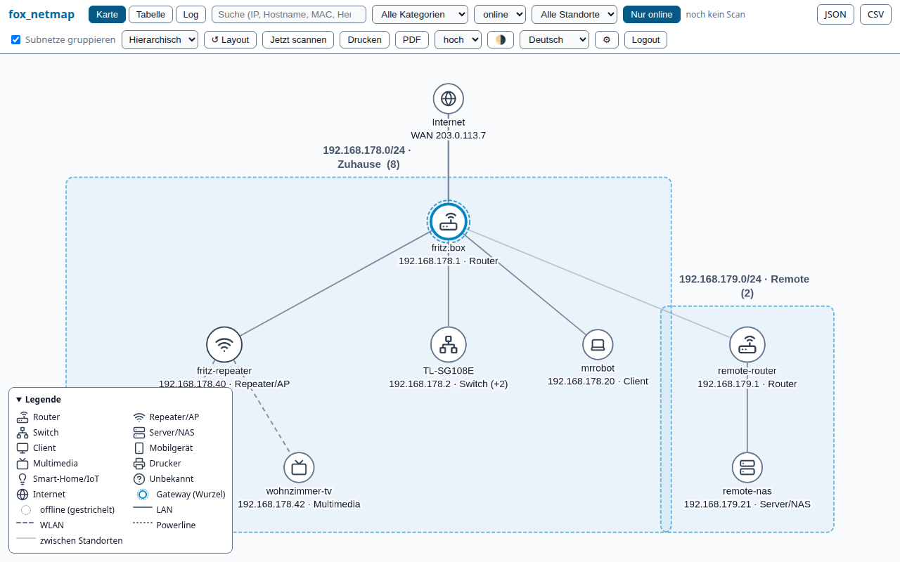
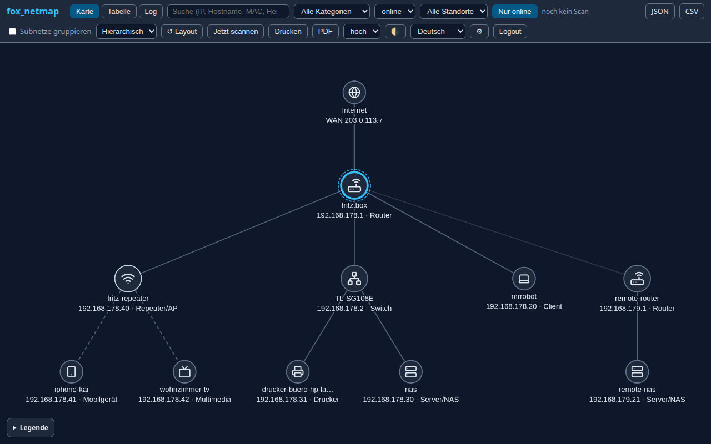
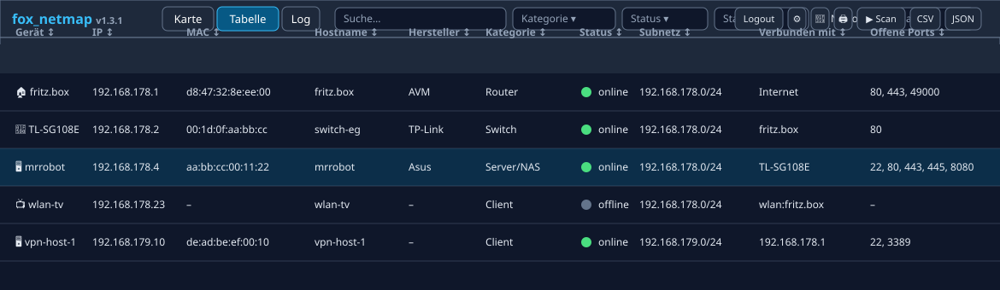

# fox_netmap — Benutzerhandbuch

Version 1.6.1 · Stand: November 2026

> Sprachen / Languages : [Deutsch](02-benutzerhandbuch.md) · [English](02-benutzerhandbuch.en.md) · [Français](02-benutzerhandbuch.fr.md) · [Español](02-benutzerhandbuch.es.md) · [Italiano](02-benutzerhandbuch.it.md) · [Português](02-benutzerhandbuch.pt.md)

fox_netmap ist eine interaktive, durchsuchbare Netzwerkkarte für das Heimnetz: bis zu ~200 Geräte
über mehrere Subnetze/VLANs, mit Topologie („Verbunden mit“), offenen Ports, Verlauf, Alarmen und
Exporten (JSON/CSV/PDF-Druck). Daten liegen persistent in SQLite, Scans laufen zyklisch oder manuell.

> Die Kartenbilder `docs/screenshots/01-karte-hell.png` und `01-karte-dunkel.png` sind echte Aufnahmen
> von v1.6.1 mit Testdaten. Die übrigen Abbildungen (`*.svg`) sind schematische Darstellungen der
> Oberfläche (Dark Theme); Aufbau und Elemente entsprechen der App.

**Inhaltsverzeichnis**

1. [Schnellstart](#1-schnellstart)
2. [Die Oberfläche](#2-die-oberfläche)
3. [Karte bedienen](#3-karte-bedienen)
4. [Tabelle](#4-tabelle)
5. [Log-Ansicht](#5-log-ansicht)
6. [Gerätedetails](#6-gerätedetails)
7. [Suchen & Filtern](#7-suchen--filtern)
8. [Einstellungen](#8-einstellungen)
9. [Embed (einbettbar, read-only)](#9-embed-einbettbar-read-only)
10. [Exporte](#10-exporte)
11. [Scanner & Datenmodell](#11-scanner--datenmodell)
12. [Topologie („Verbunden mit“)](#12-topologie-verbunden-mit)
13. [Mehrere Standorte & IPv6](#13-mehrere-standorte--ipv6)
14. [Sicherheit](#14-sicherheit)
15. [Betrieb & Deployment](#15-betrieb--deployment)
16. [REST-API (Kurzüberblick)](#16-rest-api-kurzüberblick)
17. [Fehlerbehebung](#17-fehlerbehebung)
18. [Barrierefreiheit](#18-barrierefreiheit)
19. [Glossar](#19-glossar)

---

## 1. Schnellstart

**Voraussetzungen:** Docker + Docker Compose auf dem Host (Scanner braucht `network_mode: host`,
damit ARP/Ping im echten Netz arbeiten).

```bash
git clone https://github.com/KaiDeWitzka/fox_netmap.git
cd fox_netmap
cp docker-compose.yml .   # liegt schon im Repo
# optional: .env anlegen, z. B.
#   NETZ_SUBNETS=192.168.178.0/24,192.168.179.0/24
#   NETZ_FRITZ_URL=http://192.168.178.1:49000
#   NETZ_FRITZ_USER=…   NETZ_FRITZ_PASS=…
docker compose up -d --build
```

- Web-UI: **http://localhost:8399**
- Beim ersten Start mit leerem `NETZ_AUTH_PASS` wird einmalig ein zufälliges Passwort erzeugt und in
  `./data/initial-admin-password.txt` abgelegt (nur für den Besitzer lesbar, nicht im Log). Login default: `admin`.
  Danach `NETZ_AUTH_PASS` setzen – die Datei wird dann automatisch gelöscht.
- Erster Scan läuft automatisch nach `NETZ_SCAN_INTERVAL` (Default 900 s) oder sofort über
  **▶ Scan** im Header.
- Daten liegen im Volume `./data` (SQLite `netmap.db`, Log `netmap.log`, Exporte) und überleben
  `docker compose up -d --build` (Recreate). **`down -v` löscht die Daten!**

> Nach Code-Updates immer `docker compose up -d --build` ausführen (neues Image + Recreate).

---

## 2. Die Oberfläche





Schematische Übersicht mit Detail-Panel: [01-karte.svg](screenshots/01-karte.svg)

Der Header ist in **zwei Zeilen nach Themenschwerpunkten gruppiert** (jede Gruppe mit kleinem Label):
Zeile 1 **Ansicht**: Logo mit **Versionsnummer** (kommt aus `/api/meta`, ändert sich mit jedem Release),
Navigation **Karte / Tabelle / Log**, Suche, Filter (Kategorie, Status, Standort), **Nur online**, Scan-Status.
Zeile 2: **Karte** (Subnetze gruppieren, Layout-Auswahl, ↺ Layout), **Aktionen** (**▶ Scan**, Exporte JSON/CSV,
PDF + Ausrichtung, Drucken) und **App** (Theme 🌗/☀, Sprache, **⚙ Einstellungen** als deutlich sichtbarer
Button mit Icon + Label, Logout).

Rechts öffnet sich bei Klick auf ein Gerät (oder über ⚙) die Seitenleiste mit den Tabs
**Details** und **Einstellungen**.

---

## 3. Karte bedienen

- **Zoom/Pan:** Mausrad zoomen, Hintergrund ziehen verschiebt. Positionen der Geräte werden
  gespeichert (Ziehen eines Knotens → wird per API persistiert).
- **Klick auf Gerät:** Spotlight — das Gerät und seine direkten Verbindungen werden hervorgehoben,
  der Rest wird abgedunkelt; Details öffnen sich rechts. Erneuter Klick auf Hintergrund hebt auf.
- **„Nur online":** Blendet offline-Geräte aus (persistiert in localStorage).
- **„Subnetze gruppieren":** Geräte werden pro Subnetz in einen Rahmen gruppiert
  (Label `Subnetz · Standort (Anzahl)`). Die Kanten bleiben zwischen den Geräten
  erhalten, auch über Subnetzgrenzen.
- **Kinder aus-/einblenden:** Im Detail-Panel von Router/Switch blendet ein Button alle direkt
  angebundenen Geräte aus; der Knoten zeigt dann `(+N)`.
- **Layout:** `auto` (Default) ordnet die Karte als Baum nach der Topologie an: Internet oben, darunter
  Router, Switche/Repeater und Endgeräte. Hängen viele Endgeräte an einem Knoten, stehen sie kompakt im
  Raster darunter; Geräte ohne Zuordnung stehen unter dem Baum. Sind für alle Geräte Positionen gespeichert
  (Ziehen), nutzt `auto` diese. Weitere Layouts: `tree` (immer Baum), `force` (Physik), `concentric`,
  `circle`, `grid`. **Reset** setzt gespeicherte Positionen zurück.
- **Knoten (seit v1.6.1):** neutraler Kreis mit Kategorie-Symbol (Lucide-Symbole, siehe `THIRD_PARTY.md`)
  statt Farbe und Emoji. Router, Switch, Repeater/AP, Server/NAS und Internet sind 40 px groß, Endgeräte 34 px.
  Für Clients unterscheidet die Karte anhand von Name und Erkennungsgrund Laptop, Tablet und Spielkonsole.
- **Beschriftung zweizeilig:** Zeile 1 der Name (ab 20 Zeichen mit „…“ gekürzt, der volle Name erscheint
  als Tooltip beim Überfahren), Zeile 2 `IP · Kategorie`, bei eingeklappten Kindern `(+N)`, bei
  offline-Geräten `· offline`. Der Internet-Knoten zeigt `Internet` und `WAN <IP>` (ohne TR-064 „?“).
  Beide Zeilen haben dieselbe Farbe, weil die Kartenbibliothek Cytoscape keine Farbe pro Zeile kennt.
- **Gateway als Wurzel:** Nur das Gerät mit der Gateway-IP (aus TR-064 oder Routing) bekommt einen
  kräftigen Ring in Akzentfarbe mit gestricheltem Außenring. Repeater/AP haben einen hellen Rand.
- **Offline:** Körper und Symbol abgeblendet, Rand gestrichelt; die Beschriftung bleibt lesbar und nennt
  „offline“, die Information hängt also nicht an der Farbe.
- **Kanten:** gerade Linien, LAN durchgezogen, WLAN gestrichelt, Powerline gepunktet. Verbindungen
  zwischen verschiedenen Standorten sind blasser. Die Internet-Anbindung ist etwas kräftiger.
- **Legende:** unten links, einklappbar (Zustand wird im Browser gespeichert, standardmäßig eingeklappt).
  Sie zeigt alle Symbole mit Kategorienamen sowie Gateway-Ring, offline und die Linienarten.
- **Automatisch aufgeräumt:** Labels erst ab Zoom ≥ 0,85 vollständig sichtbar (darunter nur Hubs:
  Router/Switch/Gateway/Internet), sehr kleine Schrift wird gar nicht gezeichnet; ab > 25 Geräten werden
  Subnetz-Gruppen automatisch aktiviert; „Nur online“ ist standardmäßig aktiv (umschaltbar).
- Virtuelle Knoten: **Internet** (mit WAN-IP), **Gateway** (falls das Gateway selbst nicht in der
  Geräteliste ist) und **wlan:…** für WLAN-Geräte ohne eigenen Knoten.
- **Tabelle und Druck:** Die Kategoriezelle zeigt dasselbe Symbol wie die Karte plus Text. Die Filter und
  das Kategorie-Auswahlfeld sind native Auswahllisten und zeigen nur Text.

---

## 4. Tabelle



- **Spalten verschieben:** Header-Zelle ziehen — Reihenfolge wird gespeichert (localStorage).
- **Spaltenbreite:** Trennlinie im Header ziehen — Breite wird gespeichert.
- **Sortieren:** Klick auf Spaltenkopf.
- **Kategorie direkt ändern:** Dropdown in der Kategorie-Spalte.
- Hostname/IP mit Web-UI-Ports (80/8080/443/8443) werden als klickbare Links (http + https,
  IPv6 in `[…]`) angezeigt.
- **IPv6-Spalte:** gefundene v6-Adresse (NDP-MAC-Match, Spalte „IPv6“) direkt in der Tabelle, „–“ wenn keine bekannt.
- Geräte ohne MAC (z. B. reine IP-Funde aus dem VPN-Subnetz) zeigen als MAC „–“.

---

## 5. Log-Ansicht


Die **Log**-Ansicht zeigtDie Level werden farbig dargestellt (INFO blau, WARN amber, ERROR rot).  `netmap.log` (rotierend, 1 MB × 3) mit Auto-Refresh alle 5 s,
Filter nach Level, und Download der kompletten Datei. Dasselbe liefern die API-Endpunkte
`/api/logs` und `/api/logs/download`.

---

## 6. Gerätedetails

Rechts im Tab **Details**: Kategorie (änderbar), IP/**IPv6** (v6 per NDP-MAC-Match aus `ip -6 neigh`, Spalte `ip6` in DB/JSON/CSV), MAC/Hostname/Hersteller (OUI), Status,
Subnetz, Standort, Quelle(n) des Scans (z. B. `arp,tr064`), „Verbunden mit“ (manuell wählbar,
leer = automatisch), offene Ports mit Dienstnamen, Notiz, Verlauf (online/offline/Ports) und
Ereignisse. **Speichern** persistiert Kategorie/Notiz/manuelle Verbindung.

---

## 7. Suchen & Filtern

- **Suche:** durchsucht Hostname, IP, MAC, Hersteller, Notiz (Live-Filter).
- **Filter:** Kategorie, Status (online/offline), Standort — kombinierbar, wirken auf Karte
  und Tabelle.
- **Nur online:** quick toggle im Header.

---

## 8. Einstellungen


Das Formular ist nach **Themenschwerpunkten gruppiert** (Allgemein · Scan · TR-064 · SNMP · Alarme · Exporte/Standorte/VPN · OUI).

Alle hier änderbaren Werte wirken **beim nächsten Scan ohne Container-Neustart** (die Compose-
Env-Werte bleiben Default für frische Installationen; leer = Env-Default).

| Feld | Env-Äquivalent | Bedeutung |
|---|---|---|
| Subnetze | `NETZ_SUBNETS` | kommagetrennt, IPv4- und IPv6-CIDR (z. B. `192.168.178.0/24, 2003:db8::/64`) |
| Scan-Intervall / Timeout | `NETZ_SCAN_INTERVAL` / `NETZ_SCAN_TIMEOUT` | Sekunden; Intervall 30–86400 |
| Port-Umfang / Eigene Ports | `NETZ_PORT_TOP` / `NETZ_PORTS` | Top-N (0 = alle) oder eigene Liste `80,443,…` |
| SNMP aktiv / Switches / Community | `NETZ_SNMP_ENABLED` / `_SWITCHES` / `_COMMUNITY` | CAM-Tabelle + LLDP der Switches (161/udp). Community ohne Standardwert (seit v1.6.0), ohne Community kein SNMP |
| TR-064 Hauptgerät / weitere Endpunkte / Benutzer / Passwort | `NETZ_FRITZ_URL` / `_URLS` / `_USER` / `_PASS` | URL oder `host:port`; Repeater als weitere Endpunkte; Passwort ist **write-only** (wird nie per GET ausgeliefert, leer = unverändert) |
| Alarm-URLs (Webhook/Gotify/Ntfy) | `NETZ_NOTIFY_*` | `http(s)://…`; Tokens bleiben env-only (`NETZ_NOTIFY_*_TOKEN`) |
| Whitelist | `NETZ_ALARM_WHITELIST` | MACs/IPs, die keinen „neues Gerät“-Alarm auslösen |
| Standorte | `NETZ_SITES` | `Name:Subnetz; …` z. B. `Zuhause:192.168.178.0/24; Remote:192.168.179.0/24` |
| VPN-Adresspool | `NETZ_VPN_POOL` | Default `off` (keine Annahme). `auto` = FRITZ!-Konvention: im Gateway-/24 letzte Oktett ≥ 201; auch CIDRs (`10.8.0.0/24`) und Bereiche (`192.168.178.201-192.168.178.254`), kommagetrennt |
| Historie / Retention | `NETZ_HISTORY_HOURS` / `NETZ_DEVICE_RETENTION_DAYS` | Verlauf in Stunden; offline-Geräte nach N Tagen löschen (0 = nie) |
| Ereignis-Löschfrist | `NETZ_EVENT_RETENTION_DAYS` | Ereignisse nach N Tagen löschen, Standard 90 (0 = nie) |
| Auto-Export / Intervall / Ordner | `NETZ_AUTO_EXPORT` / `_INTERVAL_HOURS` / `_DIR` | JSON+CSV automatisch; Intervall in h (0 = nach jedem Scan) |
| mDNS | `NETZ_MDNS_ENABLED` | Hostnamen per mDNS-PTR als Fallback (+ DNS-SD, v1.6.0) |
| Online-OUI-Fallback / max. Lookups pro Scan / API-URL | `NETZ_OUI_ONLINE_ENABLED` / `_MAX` / `_URL` | Hersteller unbekannter MACs online nachschlagen (Default `https://api.macvendors.com`), **Default aus** (Datenschutz: MAC-Präfixe gehen an einen Drittanbieter), gecacht in der DB |
| Login aktiv | `NETZ_AUTH_ENABLED` | Session-Login an/aus (User/Pass bleiben env-only) |
| Theme / Sprache | `NETZ_THEME` / `NETZ_LANG` | dark/light; de/en/fr/es/it/pt |

**Plausibilitätsprüfung:** Ungültige Eingaben (z. B. `keine-ip` als Subnetz, Port `abc`,
Webhook ohne `https://`) werden sofort im Frontend gemeldet und vom Backend mit HTTP 422
abgewiesen.

---

## 9. Embed (einbettbar, read-only)

In den Einstellungen (Bereich **Embed-Tokens**) Token anlegen — optional mit Ablaufdatum und
Filtern (Subnetze/Kategorien). Einbettung per:

```html
<iframe src="https://netmap.example.de/embed?token=ABC123&lang=de" width="100%" height="600"></iframe>
```

Das Token wird nur direkt nach dem Anlegen angezeigt, gespeichert wird nur ein Hash (seit v1.6.0). Bitte sofort kopieren; die Liste zeigt danach nur die ersten 6 Zeichen.

Der Embed ist read-only (keine Bearbeitung, keine Settings), respektiert die Token-Filter und
kann über `?theme=dark|light` und `?lang=…` angepasst werden.

---

## 10. Exporte

- **JSON / CSV** im Header: kompletter Export aller Geräte inkl. Ports, Verlauf, Verbindungen,
  Standorte, Anschluss am Elternknoten (`link_port`, z. B. `LAN:2` / `AP:5G:0` aus dem FRITZ!Box-Mesh)
  und VPN-Kennzeichen (`vpn`). CSV mit wählbarem Trennzeichen (`/api/export/csv?sep=;`).
- **Drucken → PDF:** druckoptimierte Ansicht (Browser „Als PDF speichern“).
- **Auto-Export:**
- **PDF (serverseitig):** Button **PDF** im Header — Karten-Snapshot (PNG) + Geräte-Tabelle als echtes PDF via `POST /api/export/pdf`  (auch mit Embed-Token, Filter via Query-Parameter). Ausrichtung hoch/quer per Select neben dem Button wählbar und gemerkt (`orientation` im POST-Body); lange Zellen werden umgebrochen statt zu überlappen. in den Einstellungen aktivieren; schreibt JSON+CSV nach jedem Intervall in
  den Export-Ordner (relativ zum Daten-Volume, Default `exports`).

---

## 11. Scanner & Datenmodell

Zwei Compose-Services teilen sich das Volume `./data`:

- `netmap` — Web/API (Port 8399)
- `netmap-scanner` — `command: ["scanner"]`, `network_mode: host`, Caps `NET_RAW`

**Quellen pro Scan (Merge-Priorität):** Ping-Sweep + ARP (`/proc/net/arp`) + TCP-Probe
(80/443/22/445/8080) für ICMP-blockierte Hosts (z. B. VPN-Subnetz) → TR-064 (Hauptgerät +
`NETZ_FRITZ_URLS`, Merge nach IP, Repeater via `tr064_parent`) → SNMP (CAM/LLDP) → mDNS/DNS.
MAC-Konflikte: ARP-MAC gewinnt. Duplikate (gleiche IP) werden beim Start automatisch zusammengeführt.

**Zyklus:** Default alle 900 s + manueller Trigger (▶ Scan). Jeder Scan schreibt Verlauf
(`device_history`), Ereignisse (`device_events`, inkl. online/offline/Port-Änderungen/neu) und
löst Alarme aus (Webhook/Gotify/Ntfy bei neuem Gerät — außer Whitelist).

**Retention:** offline-Geräte werden nach `NETZ_DEVICE_RETENTION_DAYS` (Default 30, 0 = nie)
gelöscht.

**Gerätekategorien (ab v1.6.0):** Router, Repeater/AP, Switch, Server/NAS, Client, Mobilgerät, Multimedia, Drucker,
Smart-Home/IoT, Unbekannt. Jedes Signal vergibt Punkte, die höchste Summe gewinnt:
Standard-Gateway (100) > FRITZ!Box-Mesh-Rolle (50) > mDNS-Modell, z. B. `iPhone14,2` (8) > Hostname (6) >
mDNS-Dienst, z. B. `_ipp._tcp` (4) > Hersteller laut OUI (3) > offene Ports (1–5) > private WLAN-Adresse (1).
Hostnamen zählen nur am Wortanfang (`ring-tuer` ja, `string` nein). Port 53 allein macht ein Gerät nicht mehr zum
Router, SMB (445) allein gilt als Client. Mehrdeutige Hersteller wie Apple, Samsung oder TP-Link werden nicht
gewertet. Zusätzlich zur Portliste prüft der Scanner einige hohe Ports, die eindeutig sind (z. B. 62078 iOS,
8009 Google Cast, 1400 Sonos, 8006 Proxmox), außer bei einer eigenen Liste in `NETZ_PORTS`. Die Detailansicht
zeigt unter **Erkannt über**, welches Signal entschieden hat. Eine von Hand gesetzte Kategorie hat immer Vorrang.
Die mDNS-Dienstsuche ist eine einzelne Anfrage im lokalen Netz und hängt an `NETZ_MDNS_ENABLED`.

---

## 12. Topologie („Verbunden mit“)

Priorität: **manuell** (Detail-Panel) > **SNMP** (CAM+LLDP) > **FRITZ!Box-Mesh** (TR-064) > **TR-064** (Repeater/Hotspot-Geräte) >
**WLAN** (`wlan:…`, wenn TR-064 den Host als WLAN markiert) > **Gateway**.
Verbindungsart `lan`/`wlan`/`plc` wird mitgespeichert. Kanten im UI zeigen vom Vorgänger zum Gerät
(Grundlage des Baum-Layouts). Ist `Verbunden mit` eine IP oder ein Hostname, wird sie auf das passende Gerät
abgebildet; nur wenn keines existiert, entsteht ein virtueller Gateway-Knoten.

**Mehrere Geräte zuordnen (seit v1.6.0):** In der Tabelle die Geräte über die Kästchen in der ersten Spalte markieren (das Kästchen im Kopf wählt alle), oben unter **Verbunden mit** den Router, Switch oder Repeater wählen und **Setzen** drücken. **auto** entfernt die manuelle Zuordnung. Die Änderung gilt für alle markierten Geräte oder für keines. Zuordnungen, die einen Kreis ergeben würden, werden abgelehnt. Die Kästchen sind per Tab und Leertaste bedienbar, das Ergebnis wird für Screenreader angesagt.

**FRITZ!Box-Mesh (ab v1.6.0):** Über TR-064 (`X_AVM-DE_GetMeshListPath`) liest fox_netmap die Mesh-Topologie der
Box: welches Gerät an welchem Repeater oder LAN-Port hängt, per LAN oder WLAN (Band). Die Detailansicht zeigt den
Anschluss, z. B. `WLAN · 5 GHz` oder `LAN · LAN 1`. Der TR-064-Benutzer braucht laut AVM-Spezifikation die
Berechtigung „App“ oder „Phone“. Abschalten mit `NETZ_FRITZ_MESH=false`. Die Mesh-Liste wird nur aus dem lokalen Netz geladen
(nur relativer Pfad, keine Weiterleitungen, max. 5 MB); die Session-ID im Pfad wird nicht protokolliert. Im Log steht
`Mesh: X Knoten, Y Repeater, Z Zuordnungen`.

**Switch-Heuristik:** Nicht verwaltete Switches sind für die Box unsichtbar. Sieht sie an einem LAN-Port mehrere
Geräte und ist genau eines davon als Switch kategorisiert, werden die übrigen diesem Switch zugeordnet. Hängen zwei
Switches am selben Port, bleibt die Zuordnung beim Router; dann hilft die manuelle Zuordnung.

---

## 13. Mehrere Standorte & IPv6

Beispiel (VPN-Standort wie im eigenen Netz):

```env
NETZ_SUBNETS=192.168.178.0/24,192.168.179.0/24
NETZ_SITES=Zuhause:192.168.178.0/24; Remote:192.168.179.0/24
```

→ Standort-Filter im Header, Spalte „Standort“ in der Tabelle, Standort-Label in den
Subnetz-Gruppen, `site`-Feld im Export. Das Remote-Subnetz wird per TCP-Probe gefunden, auch
wenn ICMP blockiert ist.

IPv6: v6-CIDR einfach in die Subnetze aufnehmen; Fund bei großen Netzen via NDP + Gateway-Ping,
bei kleinen zusätzlich Sweep; Gateway-v6 für die Topologie; Web-Links als `[2003:db8::10]:8080`. Bei großen Netzen (z. B. /64) zusätzlich: ff02::1-Multicast-Ping, SLAAC/EUI-64-Kandidaten pro bekannter MAC (ping6) und DNS-AAAA pro Hostname — gefundene globale v6-Adressen landen in `devices.ip6` (Tabelle, Detail, Export).

**VPN-Clients (z. B. FRITZ!Box IPSec/WireGuard .201/.202):** TR-064 meldet VPN-Verbindungen mit
Schnittstellentyp „VPN“ — solche Geräte werden automatisch als VPN markiert (Badge „VPN“ in Tabelle
und Karte, Zeile „VPN-Verbindung“ im Detail-Panel, `vpn`-Feld in JSON/CSV/API). WireGuard-Peers
erscheinen nicht in TR-064; dafür greift der konfigurierbare **VPN-Adresspool** (z. B. `auto`).
VPN-Geräte lösen keinen „neues Gerät“-Alarm aus, weil sie mit dem Tunnel kommen und gehen.

---

## 14. Sicherheit

- **Seit v1.5.0:** Passwort-Hash PBKDF2-SHA256 mit 600.000 Runden (alte Hashes werden beim nächsten Login automatisch umgestellt); abgelaufene Sessions werden aufgeräumt; Session-Cookie bei HTTPS mit `Secure` (`NETZ_COOKIE_SECURE=auto|true|false`); Online-Herstellerabfrage standardmäßig aus.
- **Seit v1.4.1:** Alle Netz- und Benutzerdaten werden vor der Anzeige HTML-codiert (XSS-Schutz); Security-Header (CSP, `X-Frame-Options`, `Referrer-Policy: no-referrer`) auf allen Antworten; Login-Sperre nach 5 Fehlversuchen (IP+Benutzer) bzw. 20 (IP) für 15 Minuten (HTTP 429).
- `NETZ_EMBED_ANCESTORS` legt fest, welche Seiten `/embed` per iframe einbinden dürfen (Default `*`; Empfehlung: eigene Domains eintragen).
- Details: [Sicherheitskonzept](03-sicherheit.md).
- Session-Login (PBKDF2, Cookie `fox_session`), default an; `NETZ_AUTH_ENABLED=false` schaltet ab.
- `NETZ_AUTH_USER`/`NETZ_AUTH_PASS` sind env-only; leeres Passwort → zufälliges Startpasswort in `./data/initial-admin-password.txt` (seit v1.5.0 nicht mehr im Log).
- `GET /api/settings` liefert **keine Secrets** (Test abgesichert): weder `auth_pass`,
  `fritz_pass` noch `notify_*_token`. TR-064-Passwort ist write-only in den Settings.
- Embed-Tokens: ablauffähig, filterbar, read-only; token-geschützte API-Pfade nur
  `/api/devices`, `/api/device/…`, `/api/export/…`.
- Scanner läuft mit minimalen Caps (`NET_RAW`), read-only auf das Netz.
- **Datenschutz:** welche Daten erhoben, gespeichert und nach außen gesendet werden, steht im [Datenschutzhinweis](04-datenschutz.md). Einzelne Geräte lassen sich seit v1.5.2 im Detail-Panel unter **Gerät löschen** samt Verlauf, Ports und Ereignissen entfernen (Rückfrage vor dem Löschen). Ist das Gerät weiter im Netz, erscheint es beim nächsten Scan neu.

---

## 15. Betrieb & Deployment

```bash
docker compose up -d --build     # nach jedem Update (Recreate, Daten bleiben in ./data)
docker compose logs -f netmap-scanner   # Scanner-Log live
docker compose down               # Stop (Daten bleiben)
docker compose down -v            # ACHTUNG: löscht ./data (DB, Log, Exporte)!
```

- Health: `GET /api/health` → `{ "status": "ok", "version": "1.5.2" }`
- Container laufen seit v1.5.0 **nicht mehr als root**, sondern als UID/GID `10001`. Die Web-Oberfläche hat keine Capabilities und ein schreibgeschütztes Root-Dateisystem; der Scanner behält nur `NET_RAW` für ping.
- Beim ersten Start nach dem Update übernimmt der Container vorhandene Dateien in `./data` automatisch für UID 10001. Auf dem Host danach `sudo` zum Lesen nutzen oder den eigenen Benutzer in eine Gruppe mit GID 10001 aufnehmen.
- Docker-Healthcheck: `docker compose ps` zeigt `healthy`/`unhealthy` (Web: `/api/health`, Scanner: Scan-Schleife läuft).
- Volumes: `./data:/data` (SQLite-WAL, `netmap.log` rotierend, `exports/`)
- Ports: `NETMAP_PORT` (Host) → 8399 (Container)
- Zeitzone: `TZ=Europe/Berlin`
- Releases: SemVer-Tags `vX.Y.Z` laufen durch `release.yml` (ruff + pytest + UI-Tests) und
  erzeugen automatisch ein GitHub-Release.
- Fertiges Image (seit v1.5.1): `docker pull ghcr.io/kaidewitzka/fox_netmap:latest` (amd64/arm64). Bei privatem Repository vorher `docker login ghcr.io` mit Token (`read:packages`). In der Compose `build: .` durch `image: ghcr.io/kaidewitzka/fox_netmap:<version>` ersetzen. Jedes Image ist mit Trivy geprüft; SBOM und Scan-Bericht hängen am GitHub-Release.

---

## 16. REST-API (Kurzüberblick)

| Endpunkt | Zweck |
|---|---|
| `GET /api/health` | Health + Version (öffentlich) |
| `GET /api/devices?q=&category=&status=&subnet=&site=` | Geräteliste, filterbar |
| `PATCH /api/device/{mac}` | Kategorie/Notiz/„Verbunden mit“/Position bearbeiten |
| `DELETE /api/device/{mac}` | Gerät samt Verlauf, Ports und Ereignissen löschen (Login nötig) |
| `GET /api/device/{mac}` | Details inkl. Ports/Verlauf/Ereignisse |
| `POST /api/scan` · `GET /api/scan/status` | Scan auslösen / Status |
| `GET /api/settings` · `PATCH /api/settings` | Settings lesen (ohne Secrets) / ändern (422 bei ungültig) |
| `GET/POST /api/tokens` · `DELETE /api/tokens/{id}` | Embed-Tokens verwalten |
| `POST /api/devices/connect` | Mehrfach-Zuordnung: `{"macs": [...], "connected_to": "<MAC>"}`, `""` = automatisch |
| `GET /api/export/json` · `GET /api/export/csv?sep=,` | Exporte |
| `GET /api/logs?lines=200&level=WARNING` · `GET /api/logs/download` | Log |
| `GET /api/meta` | WAN-IP, Gateway, Version, Subnetze (öffentlich) |
| `GET /api/sites` · `GET /api/categories` | Standorte / Kategorien (öffentlich) |
| `POST /api/layout/reset` | gespeicherte Knoten-Positionen löschen |

Auth: Session-Cookie nach `POST /api/login`; Embed-Token statt Session für die Token-Pfade.

---

## 17. Fehlerbehebung

| Symptom | Ursache / Lösung |
|---|---|
| „Zu viele Fehlversuche“ beim Login | Login-Sperre aktiv (HTTP 429). 15 Minuten warten oder Container neu starten (`docker compose restart netmap`). |
| Embed wird im iframe nicht angezeigt | `NETZ_EMBED_ANCESTORS` enthält die einbettende Seite nicht. Domain ergänzen und `docker compose up -d`. |
| Gerät fehlt im VPN-Subnetz | ICMP blockiert → TCP-Probe greift automatisch; im Log (`WARN … TCP-Probe ok`) sichtbar. Subnetz in den Settings eintragen. |
| TR-064-Fehler im Log | https→http-Fallback automatisch; URL/User/Pass in den Settings prüfen (Passwort write-only). SOAP-Fehler werden als Klartext geloggt. |
| Switch ohne Nachbarn | TL-SG108E o. Ä. ohne SNMP → Port 80 only; Topologie dann manuell im Detail-Panel setzen. |
| „Doppeltes“ Gerät | Gleiche IP mit zwei MACs → ARP-MAC gewinnt, Rest wird beim Start dedupliziert. |
| Alte Geräte verschwinden | Retention aktiv (Default 30 Tage offline) — in den Settings auf `0` = nie stellen. |
| Karte unübersichtlich | „Subnetze gruppieren“ + Router/Switch „Kinder ausblenden“ + Layout `tree`/`grid` testen. |
| Login vergessen | `NETZ_AUTH_PASS` in der Compose/.env setzen und `docker compose up -d --build`. |
| Alles neu aufsetzen | `docker compose down -v && docker compose up -d --build` — löscht DB! Exporte vorher sichern. |

Log-Seite (Tab **Log**) + `docker compose logs netmap-scanner` zeigen jeden Scan-Schritt.

---

## 18. Barrierefreiheit

- Tastaturbedienung: Tab-Navigation durch Header/Views, Enter aktiviert; Fokus-Ringe sichtbar.
- Kontraste im Dark/Light Theme geprüft, Status zusätzlich zur Farbe textlich („online/offline“).
- aria-labels auf icon-only-Buttons, Live-Region für Statusmeldungen.
- Restliche BITV-2.1-Konformität ist Ziel, Feedback willkommen (Issue im Repo).
- **Bewegung reduzieren (seit v1.5.2):** Ist im Betriebssystem „Bewegung reduzieren“ aktiv (`prefers-reduced-motion`), zeigt fox_netmap keine Animationen und Übergänge; der laufende Scan ist dann als ruhiger Punkt plus Text erkennbar. Ohne diese Einstellung pulsiert der Punkt nur dreimal (unter 5 Sekunden) und bleibt dann stehen (WCAG 2.2.2, 2.3.3). Die Karte wird grundsätzlich ohne Animation aufgebaut.
- **Karte (seit v1.6.1):** Kategorien sind als Symbol plus Text erkennbar, nicht nur über Farbe (WCAG 1.4.1).
  Geprüfte Kontraste beider Themes: Beschriftung mindestens 4,5:1 (auch offline), Knotenränder und
  Symbole mindestens 3:1 gegen den Hintergrund (WCAG 1.4.3, 1.4.11). Die Legende ist ein natives
  `<details>`-Element und per Tastatur bedienbar; Symbole darin und in der Tabelle sind dekorativ
  (`alt=""`), weil der Kategorietext daneben steht. Gekürzte Namen sind als Tooltip, in der Tabelle und
  im Detail-Panel vollständig lesbar. Übergänge (150 ms) entfallen bei „Bewegung reduzieren“.
- Der Scan-Status wird Screenreadern nur bei echten Änderungen angesagt, nicht bei jeder Abfrage.

---

## 19. Glossar

- **OUI** — Herstellerkennung anhand der ersten 3 MAC-Bytes (lokale DB `app/data/oui_seed.txt`).
- **TR-064** — AVM-SOAP-Schnittstelle der FRITZ!Box (Hostliste, WAN-IP, WLAN-Clients).
- **CAM-Tabelle** — Switch-MAC-Port-Tabelle via SNMP (Q-BRIDGE/BRIDGE-MIB).
- **LLDP** — Nachbarerkennung via SNMP (LLDP-MIB), z. B. `lldpRemChassisId`.
- **Retention** — automatische Löschung lange offline gewesener Geräte.
- **Spotlight** — Hervorhebung eines Geräts + seiner direkten Verbindungen auf der Karte.
- **Standort** — benannter Name für ein Subnetz (`NETZ_SITES`), z. B. „Remote“ für das VPN-Netz.

---

*Fragen oder Fehler? Issue im Repo `KaiDeWitzka/fox_netmap` anlegen — Anforderungen stehen in
`docs/01-anforderungen.md`.*
