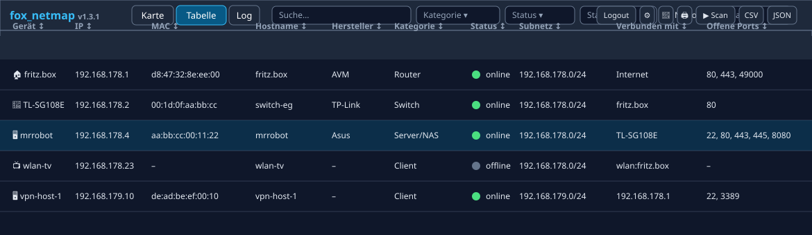

# fox_netmap — Manual do utilizador

Versão 1.3.x · novembro de 2026

> Idiomas: [Deutsch](02-benutzerhandbuch.md) · [English](02-benutzerhandbuch.en.md) · [Français](02-benutzerhandbuch.fr.md) · [Español](02-benutzerhandbuch.es.md) · [Italiano](02-benutzerhandbuch.it.md) · [Português](02-benutzerhandbuch.pt.md)

O fox_netmap é um mapa de rede interativo e pesquisável para a sua rede doméstica: até ~200
dispositivos em várias sub-redes/VLANs, com topologia («ligado a»), portas abertas, histórico,
alarmes e exportaciones (JSON/CSV/impressão PDF). Os dados são persistentes em SQLite; as
pesquisas (scans) são cíclicas ou manuais.

> As imagens deste manual (`docs/screenshots/*.svg`) são ilustrações esquemáticas da interface
> real (tema escuro): a estrutura e os elementos correspondem 1:1 à aplicação.

**Índice**

1. [Início rápido](#1-início-rápido)
2. [A interface](#2-a-interface)
3. [Usar o mapa](#3-usar-o-mapa)
4. [Tabela](#4-tabela)
5. [Vista de Registo](#5-vista-de-registo)
6. [Detalhes do dispositivo](#6-detalhes-do-dispositivo)
7. [Pesquisa e filtros](#7-pesquisa-e-filtros)
8. [Definições](#8-definições)
9. [Incorporação (embed, só de leitura)](#9-incorporação-embed-só-de-leitura)
10. [Exportações](#10-exportações)
11. [Scanner e modelo de dados](#11-scanner-e-modelo-de-dados)
12. [Topologia («ligado a»)](#12-topologia-ligado-a)
13. [Vários locais e IPv6](#13-vários-locais-e-ipv6)
14. [Segurança](#14-segurança)
15. [Operação e deploy](#15-operação-e-deploy)
16. [API REST (resumo)](#16-api-rest-resumo)
17. [Resolução de problemas](#17-resolução-de-problemas)
18. [Acessibilidade](#18-acessibilidade)
19. [Glossário](#19-glossário)

---

## 1. Início rápido

**Requisitos:** Docker + Docker Compose no host (o scanner precisa de `network_mode: host`
para que ARP/ping funcionem na rede real).

```bash
git clone https://github.com/KaiDeWitzka/fox_netmap.git
cd fox_netmap
# opcional: criar .env, p. ex.
#   NETZ_SUBNETS=192.168.178.0/24,192.168.179.0/24
#   NETZ_FRITZ_URL=http://192.168.178.1:49000
#   NETZ_FRITZ_USER=…   NETZ_FRITZ_PASS=…
docker compose up -d --build
```

- Interface web: **http://localhost:8399**
- No primeiro arranque com `NETZ_AUTH_PASS` vazio, uma palavra-passe aleatória é impressa uma vez
  nos logs (`docker compose logs netmap | grep Passwort`). Login predefinido: `admin`.
- A primeira scan corre automaticamente após `NETZ_SCAN_INTERVAL` (900 s por defeito) ou de
  imediato via **▶ Scan** no cabeçalho.
- Os dados ficam no volume `./data` (SQLite `netmap.db`, log `netmap.log`, exportações) e
  sobrevivem a `docker compose up -d --build` (recriação). **`down -v` apaga os dados!**

> Após cada atualização de código, executar sempre `docker compose up -d --build`.

---

## 2. A interface


O cabeçalho contém (da esq. para a dir.): logótipo/versão, navegação **Mapa / Tabela / Registo**,
pesquisa, filtros (categoria, estado, local), **Apenas online**, seletor de esquema, exportaciones
(JSON/CSV), **▶ Scan**, imprimir (PDF), tema (🌙/☀), **⚙ Definições**, terminar sessão.

Clicar num dispositivo (ou em ⚙) abre o painel direito com os separadores **Detalhes** e
**Definições**.

---

## 3. Usar o mapa

- **Zoom/pan:** a roda faz zoom, arrastar o fundo desloca. As posições dos dispositivos são
  guardadas (arrastar um nó é persistido via API).
- **Clicar num dispositivo:** destaque (spotlight) — o dispositivo e as suas ligações diretas são
  evidenciados, o resto escurece; os detalhes abrem à direita. Novo clique no fundo limpa.
- **«Apenas online»:** esconde dispositivos offline (guardado em localStorage).
- **«Agrupar sub-redes»:** os dispositivos são agrupados por sub-rede numa moldura (etiqueta
  `sub-rede · local (nº)`). As arestas entre sub-redes diferentes vão de grupo para grupo.
- **Ocultar/mostrar filhos:** no painel de detalhes de um router/switch, um botão oculta todos os
  dispositivos ligados diretamente; o nó mostra então `(+N)`.
- **Esquema:** `auto` (física, predefinido), `force`, `tree`, `concentric`, `circle`, `grid`;
  **Repor** limpa as posições guardadas.
- Nós virtuais: **🌐 Internet** (com IP WAN do TR-064, senão «?»), **🏠 Gateway** (se o gateway
  não estiver na lista) e **📶 wlan:…** para dispositivos WLAN sem nó próprio.
- Emoji de categoria nos nós: 🏠 Router · 🔀 Switch · 🖥 Servidor/NAS · 💻 Cliente · 🖨 Impressora ·
  💡 Casa inteligente/IoT · ❓ Desconhecido.

---

## 4. Tabela



- **Reordenar colunas:** arrastar uma célula de cabeçalho — a ordem é guardada (localStorage).
- **Largura das colunas:** arrastar o divisor no cabeçalho — a largura é guardada.
- **Ordenar:** clicar num cabeçalho de coluna.
- **Alterar categoria em linha:** lista pendente na coluna de categoria.
- Host/IP com portas de interface web (80/8080/443/8443) são apresentados como ligações clicáveis
  (http + https, IPv6 entre `[…]`).
- Dispositivos sem MAC (p. ex. IPs avulsos da sub-rede VPN) mostram «–» como MAC.

---

## 5. Vista de Registo


A vista **Registo** mostra o `netmap.log` (rotativo, 1 MB × 3) com atualização automática a cada
5 s, filtro por nível e transferência do ficheiro completo. O mesmo é fornecido por `/api/logs` e
`/api/logs/download`.

---

## 6. Detalhes do dispositivo

À direita, separador **Detalhes**: categoria (editável), IP/MAC/hostname/fabricante (OUI), estado,
sub-rede, local, fonte(s) da scan (p. ex. `arp,tr064`), «ligado a» (selecionável manualmente, vazio =
automático), portas abertas com nomes de serviço, nota, histórico (online/offline/portas) e eventos.
**Guardar** persiste categoria/nota/ligação manual.

---

## 7. Pesquisa e filtros

- **Pesquisa:** procura em hostname, IP, MAC, fabricante, nota (filtro em tempo real).
- **Filtros:** categoria, estado (online/offline), local — combináveis, aplicam-se ao mapa e à tabela.
- **Apenas online:** botão rápido no cabeçalho.

---

## 8. Definições


Tudo o que for alterado aqui tem efeito **na próxima scan sem reiniciar o contentor** (os valores
env do compose continuam a ser os predefinidos para novas instalações; vazio = predefinido env).

| Campo | Equivalente env | Significado |
|---|---|---|
| Sub-redes | `NETZ_SUBNETS` | separadas por vírgulas, CIDR IPv4 e IPv6 (p. ex. `192.168.178.0/24, 2003:db8::/64`) |
| Intervalo / timeout da scan | `NETZ_SCAN_INTERVAL` / `NETZ_SCAN_TIMEOUT` | segundos; intervalo 30–86400 |
| Âmbito de portas / portas próprias | `NETZ_PORT_TOP` / `NETZ_PORTS` | top N (0 = todas) ou lista própria `80,443,…` |
| SNMP ativo / switches / community | `NETZ_SNMP_ENABLED` / `_SWITCHES` / `_COMMUNITY` | tabela CAM + LLDP dos switches (161/udp) |
| TR-064 dispositivo principal / outros endpoints / utilizador / palavra-passe | `NETZ_FRITZ_URL` / `_URLS` / `_USER` / `_PASS` | URL ou `host:porta`; repetidores como endpoints extra; a palavra-passe é **write-only** (o GET nunca a devolve, vazia = inalterada) |
| URL de alarme (webhook/Gotify/Ntfy) | `NETZ_NOTIFY_*` | `http(s)://…`; os tokens ficam só em env (`NETZ_NOTIFY_*_TOKEN`) |
| Whitelist | `NETZ_ALARM_WHITELIST` | MAC/IP que não disparam o alarme «novo dispositivo» |
| Locais | `NETZ_SITES` | `Nome:sub-rede; …` p. ex. `Casa:192.168.178.0/24; Remoto:192.168.179.0/24` |
| Histórico / retenção | `NETZ_HISTORY_HOURS` / `NETZ_DEVICE_RETENTION_DAYS` | histórico em horas; apagar dispositivos offline após N dias (0 = nunca) |
| Auto-exportação / intervalo / pasta | `NETZ_AUTO_EXPORT` / `_INTERVAL_HOURS` / `_DIR` | JSON+CSV automáticos; intervalo em h (0 = após cada scan) |
| mDNS | `NETZ_MDNS_ENABLED` | hostnames via mDNS PTR como recurso |
| Login ativo | `NETZ_AUTH_ENABLED` | login por sessão on/off (utilizador/palavra-passe ficam só em env) |
| Tema / idioma | `NETZ_THEME` / `NETZ_LANG` | dark/light; de/en/fr/es/it/pt |

**Validação:** entradas inválidas (p. ex. `nao-e-ip` como sub-rede, porta `abc`, webhook sem
`https://`) são indicadas de imediato no frontend e rejeitadas pelo backend com HTTP 422.

---

## 9. Incorporação (embed, só de leitura)

Em Definições (**Tokens de incorporación**) crie um token — opcionalmente com expiração e filtros
(sub-redes/categorias). Incorporação via:

```html
<iframe src="https://netmap.example.com/embed?token=ABC123&lang=pt" width="100%" height="600"></iframe>
```

O embed é só de leitura (sem edição, sem definições), respeita os filtros do token e pode ser
ajustado com `?theme=dark|light` e `?lang=…`.

---

## 10. Exportações

- **JSON / CSV** no cabeçalho: exportação completa de todos os dispositivos (portas, histórico,
  ligações, locais). CSV com separador à escolha (`/api/export/csv?sep=;`).
- **Imprimir → PDF:** vista otimizada para impressão (navegador «Guardar como PDF»).
- **Auto-exportação:**
- **PDF (no servidor):** botão **PDF** no cabeçalho — captura do mapa (PNG) + tabela de dispositivos como PDF real via `POST /api/export/pdf` (também com token, filtros via parâmetros de consulta). ativar em Definições; escreve JSON+CSV após cada intervalo na pasta de
  exportação (relativa ao volume de dados, predefinida `exports`).

---

## 11. Scanner e modelo de dados

Dois serviços compose partilham o volume `./data`:

- `netmap` — web/API (porta 8399)
- `netmap-scanner` — `command: ["scanner"]`, `network_mode: host`, caps `NET_RAW`/`NET_ADMIN`

**Fontes por scan (prioridade de junção):** varrimento ping + ARP (`/proc/net/arp`) + sonda TCP
(80/443/22/445/8080) para hosts bloqueados em ICMP (p. ex. sub-rede VPN) → TR-064 (dispositivo
principal + `NETZ_FRITZ_URLS`, junção por IP, repetidores via `tr064_parent`) → SNMP (CAM/LLDP)
→ mDNS/DNS. Conflitos de MAC: vence a MAC ARP. Duplicados (mesmo IP) são unidos no arranque.

**Ciclo:** a cada 900 s por defeito + acionamento manual (▶ Scan). Cada scan escreve o histórico
(`device_history`), eventos (`device_events`: online/offline/portas alteradas/novo) e dispara
alarmes (webhook/Gotify/Ntfy para novo dispositivo — exceto whitelist).

**Retenção:** dispositivos offline são apagados após `NETZ_DEVICE_RETENTION_DAYS` (30 por
 defeito, 0 = nunca).

---

## 12. Topologia («ligado a»)

Prioridade: **manual** (painel de detalhes) > **SNMP** (CAM+LLDP) > **TR-064** (repetidores) >
**WLAN** (`wlan:…` se o TR-064 marcar o host como WLAN) > **gateway**.
O tipo de ligação `lan`/`wlan` também é guardado. Com os grupos de sub-redes ativos, as arestas
entre sub-redes vão de grupo para grupo.

---

## 13. Vários locais e IPv6

Exemplo (local VPN como na sua própria rede):

```env
NETZ_SUBNETS=192.168.178.0/24,192.168.179.0/24
NETZ_SITES=Casa:192.168.178.0/24; Remoto:192.168.179.0/24
```

→ filtro de local no cabeçalho, coluna «Local» na tabela, etiqueta de local nos grupos de
sub-redes, campo `site` nas exportações. A sub-rede remota é descoberta por sonda TCP mesmo que
ICMP esteja bloqueado.

IPv6: basta adicionar um CIDR v6 às sub-redes; descoberta em redes grandes via NDP + ping ao
gateway, mais varrimento em redes pequenas; gateway-v6 para a topologia; ligações web como
`[2003:db8::10]:8080`.

---

## 14. Segurança

- Login por sessão (PBKDF2, cookie `fox_session`), ativo por defeito; `NETZ_AUTH_ENABLED=false` desativa-o.
- `NETZ_AUTH_USER`/`NETZ_AUTH_PASS` são só env; palavra-passe vazia → uma aleatória é registada uma vez.
- `GET /api/settings` **não devolve segredos** (coberto por teste): nem `auth_pass`, nem
  `fritz_pass`, nem `notify_*_token`. A palavra-passe TR-064 é write-only nas Definições.
- Tokens de embed: com expiração, filtáveis, só de leitura; os caminhos de API protegidos por
  token são apenas `/api/devices`, `/api/device/…`, `/api/export/…`.
- O scanner corre com caps mínimas (`NET_RAW`, `NET_ADMIN`), só de leitura para a rede.

---

## 15. Operação e deploy

```bash
docker compose up -d --build          # após cada atualização (recria, os dados ficam em ./data)
docker compose logs -f netmap-scanner  # logs do scanner em direto
docker compose down                    # parar (os dados ficam)
docker compose down -v                 # ATENÇÃO: apaga ./data (BD, log, exportações)!
```

- Saúde: `GET /api/health` → `{ "status": "ok", "version": "1.3.1" }`
- Volumes: `./data:/data` (SQLite WAL, `netmap.log` rotativo, `exports/`)
- Portas: `NETMAP_PORT` (host) → 8399 (contentor)
- Fuso horário: `TZ=Europe/Berlin`
- Releases: as tags SemVer `vX.Y.Z` passam por `release.yml` (ruff + pytest + testes UI) e criam
  automaticamente uma release no GitHub.

---

## 16. API REST (resumo)

| Endpoint | Objetivo |
|---|---|
| `GET /api/health` | saúde + versão (público) |
| `GET /api/devices?q=&category=&status=&subnet=&site=` | lista de dispositivos, filtrável |
| `PATCH /api/device/{mac}` | editar categoria/nota/«ligado a»/posição |
| `GET /api/device/{mac}` | detalhes (portas/histórico/eventos) |
| `POST /api/scan` · `GET /api/scan/status` | iniciar scan / estado |
| `GET /api/settings` · `PATCH /api/settings` | ler definições (sem segredos) / alterar (422 se inválido) |
| `GET/POST /api/tokens` · `DELETE /api/tokens/{id}` | gerir tokens de embed |
| `GET /api/export/json` · `GET /api/export/csv?sep=,` | exportações |
| `GET /api/logs?lines=200&level=WARNING` · `GET /api/logs/download` | registo |
| `GET /api/meta` | IP WAN, gateway, versão, sub-redes (público) |
| `GET /api/sites` · `GET /api/categories` | locais / categorias (público) |
| `POST /api/layout/reset` | limpar posições de nós guardadas |

Auth: cookie de sessão após `POST /api/login`; token de embed em vez de sessão para os caminhos com token.

---

## 17. Resolução de problemas

| Sintoma | Causa / solução |
|---|---|
| Dispositivo em falta na sub-rede VPN | ICMP bloqueado → a sonda TCP entra automaticamente; visível no registo (`WARN … TCP probe ok`). Adiciona a sub-rede em Definições. |
| Erros TR-064 no registo | a passagem https→http é automática; verifica URL/utilizador/palavra-passe em Definições. As falhas SOAP são registadas em texto simples. |
| Switch sem vizinhos | TL-SG108E etc. sem SNMP → apenas porta 80; define a topologia manualmente no painel de detalhes. |
| Dispositivo «duplicado» | mesmo IP com dois MAC → vence a MAC ARP, o resto é desduplicado no arranque. |
| Dispositivos antigos desaparecem | retenção ativa (30 dias offline por defeito) — coloca `0` = nunca em Definições. |
| Mapa ilegível | ativa «Agrupar sub-redes» + oculta os filhos do router/switch + experimenta os esquemas `tree`/`grid`. |
| Login esquecido | define `NETZ_AUTH_PASS` no compose/.env e `docker compose up -d --build`. |
| Recomeçar do zero | `docker compose down -v && docker compose up -d --build` — apaga a BD! Guarda as exportações antes. |

O separador **Registo** + `docker compose logs netmap-scanner` mostram cada passo da scan.

---

## 18. Acessibilidade

- Navegação por teclado: Tab pelo cabeçalho/vistas, Enter ativa; anéis de foco visíveis.
- Contrastes verificados nos temas escuro/claro; o estado também é textual («online/offline»), não só cor.
- aria-labels em botões só de ícone, região live para mensagens de estado.
- O objetivo é a conformidade total com BITV 2.1 — feedback bem-vindo (issue no repo).

---

## 19. Glossário

- **OUI** — identificação do fabricante pelos primeiros 3 bytes do MAC (BD local `app/data/oui_seed.txt`).
- **TR-064** — interface SOAP da AVM da FRITZ!Box (lista de hosts, IP WAN, clientes WLAN).
- **Tabela CAM** — tabela MAC-porta do switch via SNMP (Q-BRIDGE/BRIDGE-MIB).
- **LLDP** — descoberta de vizinhos via SNMP (LLDP-MIB), p. ex. `lldpRemChassisId`.
- **Retenção** — eliminação automática de dispositivos há muito tempo offline.
- **Destaque (spotlight)** — realce de um dispositivo + as suas ligações diretas no mapa.
- **Local** — um nome para uma sub-rede (`NETZ_SITES`), p. ex. «Remoto» para a rede VPN.

---

*Perguntas ou bugs? Abre uma issue em `KaiDeWitzka/fox_netmap` — os requisitos estão em
`docs/01-anforderungen.md`.*
